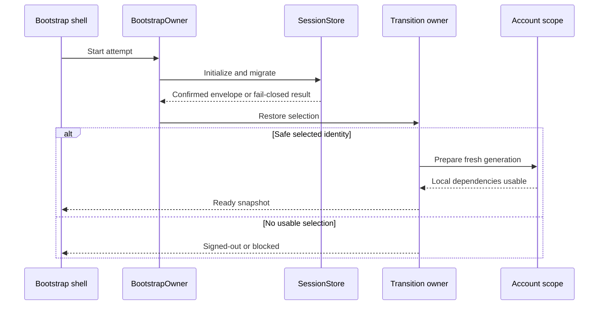
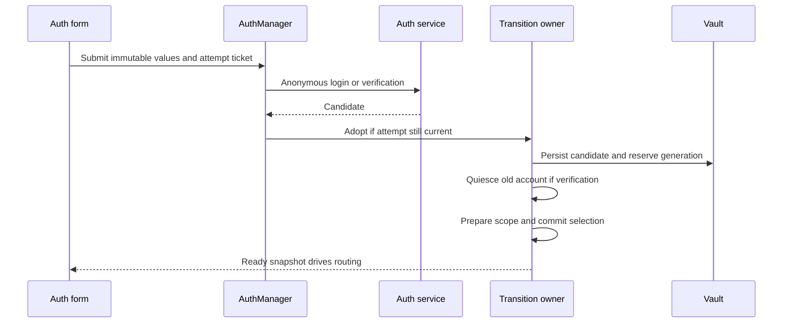
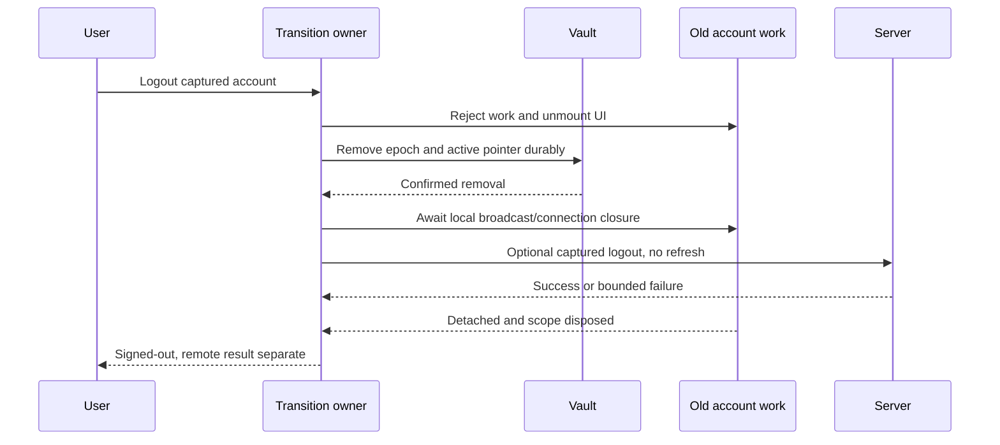
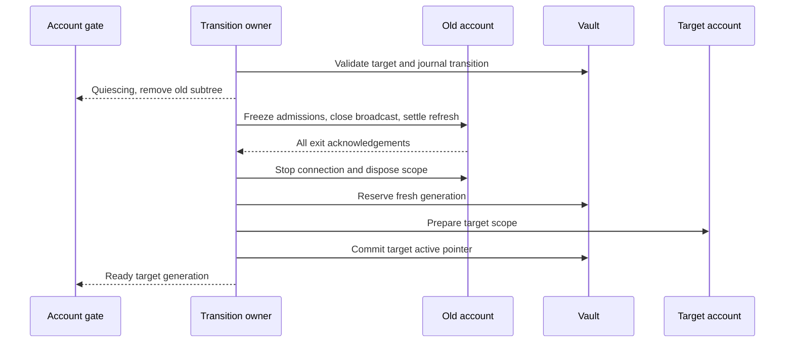
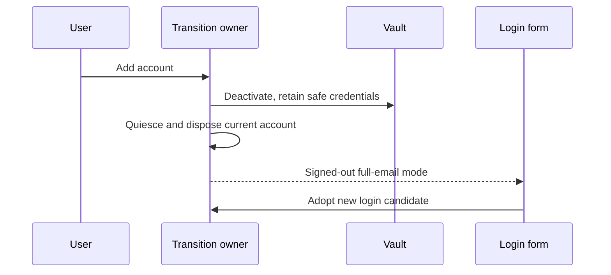
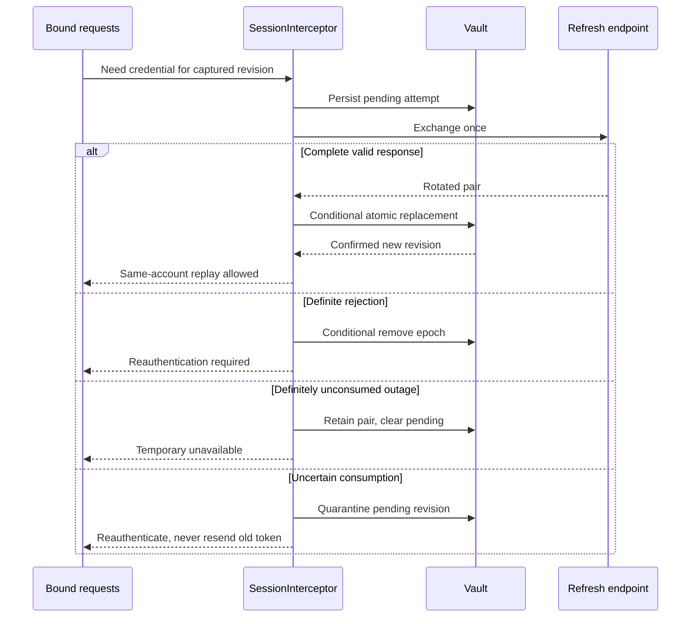
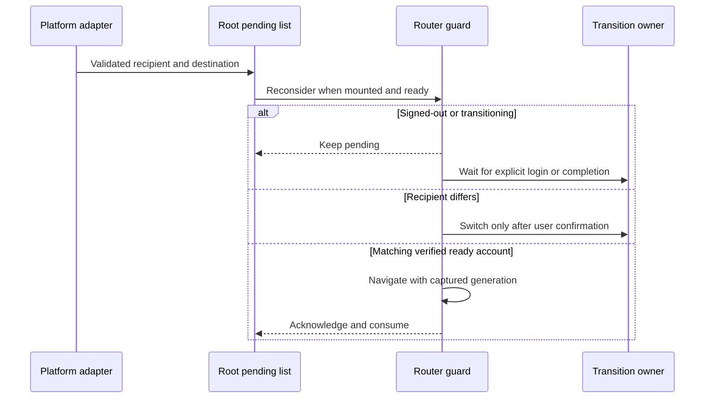

# 0. Header

# Account and App-DI Migration Design

- Date: 2026-10-24.
- Status: **design, not implemented**. This document specifies directions and language-agnostic pseudo-code; it does not authorize source changes as part of this documentation task.
- Audit: [Architecture audit](audit-report.md), especially Section 1.4 and findings C01–I02. The report is available; IDs below are its original IDs, not newly inferred IDs.
- Skills consulted before design: `flutter-it`, `flutter-architecture-expert`, `get-it-expert`, `watch-it-expert`, `command-it-expert`, `listen-it-expert`, `feed-datasource-expert`.
- Evidence paths are relative to the monorepo. In Section 2, `lib/` abbreviates `apps/mobile/lib/`; `test/` abbreviates `apps/mobile/test/`. Proposed paths in Section 8 are explicitly directions, not claims that files already exist.

Migrate account persistence, authentication coordination and app composition to an identity-bound lifecycle with exactly two application DI tiers: `root` and one `authenticated` account scope. A transition must never publish an account before its scope is usable, replay another account's request, resurrect logged-out credentials, or apply a disposed owner's result. Retain constructor injection, one app-wide ObjectBox handle, typed failures, strict analysis, the narrow media adapter, `RoomTransport`, and widget-owned feeds. Non-goals: broadcast session internals, WebSocket framing/reconnect protocol design, durable notification internals, new chats/notes/discover implementations, backend fixes, release provisioning, localization, and unrelated UI repairs. [C01–C04, H01, H02, H09, H10, H15, M05, M14, M18, M21, M22, I02]

### Skill rule register

The rule keys below are specific citations to the loaded skills. Each design subsection names its applicable rules; directions and pseudo-code inherit that subsection's finding IDs and rule keys unless a narrower tag is given. These are design constraints, not claims that skills prescribe Meno's domain semantics.

| Key | Skill and specific rule                                                                                                                            | Application                                                                                                 |
| --- | -------------------------------------------------------------------------------------------------------------------------------------------------- | ----------------------------------------------------------------------------------------------------------- |
| S1  | `flutter-it`: independent construction-set packages; adopt only needed building blocks                                                             | No new event bus, generic framework, or interface layer.                                                    |
| S2  | `flutter-architecture-expert`: Services wrap external boundaries; Managers own semantic business logic; Views mutate through Managers              | Separate vault, HTTP, transition policy and UI actions.                                                     |
| S3  | `flutter-architecture-expert`: feature-first folders; shared only when genuinely shared; no interfaces by default                                  | Auth persistence in auth; composition in app; concrete collaborators with fakes.                            |
| S4  | `get-it-expert`: scope shadowing is top-down; scope pop is asynchronous and must be awaited; disposal belongs to registrations                     | One account scope; explicit quiescence before awaited pop; no token re-registration.                        |
| S5  | `get-it-expert`: register base dependencies before app execution; initialization via direct init; dependency ordering/readiness before retrieval   | Root registrations precede first app frame; dynamic account registrations precede account UI.               |
| S6  | `flutter-architecture-expert`: initialization uses direct operations, not nested commands; commands are UI-facing                                  | Plain transition/start/stop methods; commands only at user-action boundary.                                 |
| S7  | `watch-it-expert`: cached watch selectors retain observables; lifecycle calls keep the same build order; widget-local disposables use `createOnce` | Generation-keyed account subtree; no account lookups in the unready branch.                                 |
| S8  | `watch-it-expert`: success handlers observe command success; errors use one error handler, not running-state inference                             | Login/verification effects and resend error ownership.                                                      |
| S9  | `command-it-expert`: restriction true disables; asynchronous commands expose loading; filters choose local versus global reaction                  | Shared action restrictions and deliberate typed errors; never use restriction as the concurrency lock.      |
| S10 | `listen-it-expert`: operators create new observables; retain derived chains; subscriptions have explicit cancellation                              | Stable auth/router/resend projections and bound presentation subscription.                                  |
| S11 | `feed-datasource-expert`: feeds normally belong to widgets through `createOnce`, not DI; proxies retain stable repository ownership                | Keep feed lifetime out of scope map; release account-bound consumers before account repositories.           |
| S12 | `flutter-architecture-expert`: explicit resource ownership, proxy identity/reference counting and constructor-testable collaborators               | Fixed profile identity, local-data facade, cancellation and fake-driven tests.                              |
| S13 | `flutter-architecture-expert` and `watch-it-expert`: global readiness belongs at UI startup gate, not in internal business orchestration           | UI observes root readiness; account owner awaits its explicit initialization steps, never global all-ready. |

# 1. Traceability Matrix

Status measures **design coverage**, not implementation closure. `Partially covered` identifies a complete account/DI slice with explicitly deferred remainder. `Backend prerequisite` is deferred backend work with a required mobile assumption in Section 11. Phases are defined in Section 9. This matrix includes all 64 audit findings to prevent an integration-only slice being mistaken for full closure. Design accounting: **21 Covered, 17 Partially covered, 20 Deferred, 6 Backend prerequisite**; thus 38 have a designed account/DI slice and 26 are wholly deferred, including the six backend prerequisites.

| Finding | Title                                                                                              | Addressed in section | Phase                         | Status / remaining boundary                                                                                                                               |
| ------- | -------------------------------------------------------------------------------------------------- | -------------------- | ----------------------------- | --------------------------------------------------------------------------------------------------------------------------------------------------------- |
| C01     | Requests can cross account boundaries during replay                                                | 3, 5.4, 6, 10        | P1                            | Covered                                                                                                                                                   |
| C02     | Session-store mutations are neither atomic nor identity-conditional                                | 3, 5.1, 7            | P1                            | Covered                                                                                                                                                   |
| C03     | Explicit logout can leave a usable session recoverable                                             | 5.1–5.3, 6, 7        | P1                            | Covered                                                                                                                                                   |
| C04     | Mobile and backend use incompatible realtime protocols                                             | 4.2, 5.6, 11         | P4                            | Partially covered — account owner/lifecycle only; raw-WebSocket protocol replacement deferred.                                                            |
| C05     | Backend access-token revocation is not enforced by the actual HTTP guard                           | 11                   | External                      | Backend prerequisite — mobile local logout cannot promise server-wide revocation.                                                                         |
| H01     | Authenticated UI is not synchronized with account-scope readiness                                  | 3, 4, 5.2, 5.9, 5.10 | P2                            | Covered                                                                                                                                                   |
| H02     | Live transitions can outlive account teardown or supersede newer sessions                          | 4.3, 4.5, 5.2        | P3                            | Partially covered — awaited account-exit contract and removal of live DI; session concurrency internals separate.                                         |
| H03     | Session disposal can access an uninitialized timer                                                 | 11                   | Separate broadcast design     | Deferred — session-owned resource initialization.                                                                                                         |
| H04     | Failed end/leave skips session closure; ended UI depends on disposed resources                     | 4.3, 4.5             | P3                            | Partially covered — account-exit closure and no scoped-session route lookup; normal end/summary internals separate.                                       |
| H05     | Broadcast end and cohost-removal contracts are wrong                                               | 11                   | Separate contracts            | Deferred — broadcast DTO/API contract work.                                                                                                               |
| H06     | No production path starts realtime delivery                                                        | 4.2, 5.6             | P4                            | Partially covered — startup ownership fully specified; actual delivery blocked on C04 protocol work.                                                      |
| H07     | Reconnection has stale credentials, conflicting state, and ignored terminal reasons                | 5.6, 11              | P4                            | Partially covered — account connection credentials/exit only; media reconnect state machine deferred.                                                     |
| H08     | Publishing permission is mistaken for creator authority                                            | 11                   | Separate broadcast design     | Deferred — session capabilities, not account DI.                                                                                                          |
| H09     | Refresh failures destroy sessions, including ambiguous rotated-token outcomes                      | 5.4–5.5, 6, 7, 11    | P1                            | Covered — safe mobile fallback requires reauthentication for ambiguous rotation; transparent recovery is a backend prerequisite.                          |
| H10     | Stored access-token expiry moves forward on every read                                             | 3, 5.1, 5.12, 7      | P1                            | Covered                                                                                                                                                   |
| H11     | Refresh, pagination, query changes, and invalidations race                                         | 11                   | Separate feed design          | Deferred — widget feed arbitration.                                                                                                                       |
| H12     | Client-filtered empty pages strand pagination                                                      | 11                   | Separate feed design          | Deferred — feed/backend filtering contract.                                                                                                               |
| H13     | Cold profile proxies share an empty identity and cannot be released correctly                      | 5.7, 10              | P4                            | Covered                                                                                                                                                   |
| H14     | Viewer-specific profile cache state leaks across accounts                                          | 5.8, 7               | P4                            | Covered                                                                                                                                                   |
| H15     | Async operations continue after their owner is disposed                                            | 3, 5.2, 5.7, 10      | P1–P4                         | Partially covered — account/profile/settings/request ownership covered; feed and broadcast continuations deferred.                                        |
| H16     | Participant UI does not implement the backend roster contract                                      | 11                   | Separate broadcast design     | Deferred — roster pagination/reconciliation.                                                                                                              |
| H17     | Backend cohost removal does not reliably revoke role or presence                                   | 11                   | External                      | Backend prerequisite — close cannot promise immediate remote role/presence repair.                                                                        |
| H18     | Backend broadcast transitions are not safely retryable                                             | 11                   | External                      | Backend prerequisite — account-exit mutation has no blind retry.                                                                                          |
| H19     | Editor progress and retries can report success without completing entry                            | 11                   | Separate broadcast design     | Deferred — editor/session entry operation.                                                                                                                |
| H20     | Broadcast mutations do not carry stable logical-operation idempotency keys                         | 5.4, 11              | Separate broadcast design     | Deferred — preserve supplied keys in transport; logical broadcast key ownership remains separate.                                                         |
| H21     | Password-reset requests revoke sessions before proving ownership                                   | 11                   | External                      | Backend prerequisite — client never treats requesting a reset as ownership proof.                                                                         |
| H22     | Notes sync can lose folders created in the same batch                                              | 11                   | External                      | Backend prerequisite — no notes sync implementation here.                                                                                                 |
| H23     | Chat deletion can mutate one room and publish to another                                           | 11                   | External                      | Backend prerequisite — no chat deletion implementation here.                                                                                              |
| H24     | Push and durable notifications are not implemented end-to-end                                      | 4.2, 5.9, 5.10, 11   | P4                            | Partially covered — root tap ingestion/account readiness boundary only; inbox/device registration/backend delivery deferred.                              |
| H25     | Client validation rejects server-valid accounts and can break credential storage                   | 5.12, 7, 10          | P1                            | Covered                                                                                                                                                   |
| M01     | Email resend availability drives an automatic resend loop                                          | 5.11, 10             | P2                            | Covered                                                                                                                                                   |
| M02     | Add-account flow retains password-only login mode                                                  | 3, 5.3, 6            | P1                            | Covered                                                                                                                                                   |
| M03     | Scoped credentials and socket tokens stay stale                                                    | 4.2, 5.4, 5.6        | P2–P4                         | Covered                                                                                                                                                   |
| M04     | Public profile page resolves an unregistered proxy                                                 | 4.4, 5.7             | P4                            | Covered                                                                                                                                                   |
| M05     | Local storage isolation is optional rather than enforced                                           | 4.2, 5.8, 7          | P4                            | Covered                                                                                                                                                   |
| M06     | ObjectBox writes can duplicate logical rows; queries lack deterministic cleanup                    | 5.8, 7               | P4                            | Covered                                                                                                                                                   |
| M07     | Favourites are disconnected snapshots                                                              | 11                   | Separate feature state design | Deferred — account binding changes do not repair favourites reactivity.                                                                                   |
| M08     | Pagination errors are absent from the feed error surface                                           | 11                   | Separate feed design          | Deferred — initial/page error UI.                                                                                                                         |
| M09     | Socket rebinding cancels the wrong handles; feed events ignore filters                             | 11                   | Separate feed design          | Deferred — feed subscriptions/query predicates.                                                                                                           |
| M10     | Invalidation parsing and event enrichment are inconsistent                                         | 11                   | Separate protocol design      | Deferred — payload/frame contracts.                                                                                                                       |
| M11     | Profile editor compares different types and ignores bio validity                                   | 5.7, 5.12            | P4                            | Covered                                                                                                                                                   |
| M12     | Current-user presentation has multiple unsynchronized sources                                      | 3, 5.3, 5.7          | P4                            | Covered                                                                                                                                                   |
| M13     | Settings writes race and overwrite unknown preference keys                                         | 5.7, 5.12, 11        | P4                            | Covered — preserves received unknown keys; cross-client lost updates require backend versioning.                                                          |
| M14     | Account-scoped managers redundantly track global account selection                                 | 4.2, 5.7             | P2                            | Covered                                                                                                                                                   |
| M15     | HTTP failure paths can hang, misclassify, or leak credentials to external origins                  | 5.4, 5.5, 10         | P1                            | Covered                                                                                                                                                   |
| M16     | Push payloads, channels, and tap lifecycle disagree                                                | 5.9, 5.10, 11        | P4                            | Partially covered — recipient/destination ingestion and foreground policy specified; platform channels/provisioning and delivery separate.                |
| M17     | Background-audio support is declared but not established                                           | 11                   | Separate platform work        | Deferred — OS audio/background execution.                                                                                                                 |
| M18     | Production can select a successful silent transport; recovery stores a bearer token in preferences | 4.3, 5.10, 7         | P1–P3                         | Covered — fail invalid production config; scrub legacy tokens; recovery internals remain separate.                                                        |
| M19     | Routing discards identity and intended destinations                                                | 4.3, 5.9, 6          | P2                            | Partially covered — account guards/pending identity covered; broadcast details/ended/live route semantics and platform links separate.                    |
| M20     | Named navigation is used for a route without that name                                             | 11                   | Separate route repair         | Deferred — unrelated broadcasts listing route.                                                                                                            |
| M21     | Scope/connection orchestration is over-commanded                                                   | 4.3, 5.2, 5.6        | P2–P3                         | Partially covered — account lifecycle and no session DI readiness covered; broadcast command pipeline/timers separate.                                    |
| M22     | Shared infrastructure imports features and broad barrels hide the dependency graph                 | 4.4, 8               | P1–P4                         | Partially covered — auth/app boundary and mandatory dependency-only relocations; broader feature cleanup remains separate.                                |
| M23     | Production logging suppresses every severity                                                       | 5.13, 10             | P1                            | Partially covered — account/global sanitized logging policy; unrelated call-site review separate.                                                         |
| M24     | Critical lifecycle tests are commented out                                                         | 10, 12               | P1–P4                         | Partially covered — account/profile suites rewritten and enabled; broadcast suites have integration replacements here and full session coverage separate. |
| M25     | Build/platform configuration is not release-ready                                                  | 11                   | Separate release work         | Deferred — provisioning, native resources and platform build audit.                                                                                       |
| M26     | UI presents incomplete behavior as operational                                                     | 11                   | Separate feature work         | Deferred — no-op actions outside this migration.                                                                                                          |
| L01     | Rebuild granularity is too broad for a one-second clock                                            | 11                   | Separate broadcast UI work    | Deferred — clock rendering, not account remount.                                                                                                          |
| L02     | Derived observables are recreated by getters                                                       | 5.3, 5.11            | P2                            | Partially covered — auth/user/router projections covered; live-manager projection separate.                                                               |
| L03     | Timer semantics and retry timing are inaccurate                                                    | 5.4, 11              | P1                            | Partially covered — HTTP retry minimum corrected; broadcast timer semantics separate.                                                                     |
| L04     | Small UI/validation mismatches remain                                                              | 11                   | Separate broadcast work       | Deferred — broadcast copy/limits/counters.                                                                                                                |
| L05     | Dead paths, fixtures, and documentation obscure the reference implementation                       | 8, 11                | P3                            | Partially covered — remove obsolete account/DI references only; fixtures/duplicate broadcast UI/README separate.                                          |
| L06     | Language setting is not connected to localization                                                  | 11                   | Separate localization work    | Deferred — locale/delegate wiring.                                                                                                                        |
| I01     | The feed base mixes unused page arithmetic with cursor pagination                                  | 11                   | Separate feed design          | Deferred — shared pagination model.                                                                                                                       |
| I02     | Dependency risk is explicit, not proven obsolescence                                               | 7, 10, 11            | P4                            | Partially covered — native migration gate and strict analysis retained; package/mock consolidation separate.                                              |

# 2. Current-State Snapshot (verified)

Static source verification only: no app, API, device, or tests were executed for this design. No scoped finding was found already fixed. Qualifications/additional hazards below refine the audit, rather than claim intervening source changes. [C01–C04, H01, H09, H10, H13–H15, H25, M01–M06, M11–M16, M18, M19, M21–M24, L02, I02]

| Area                       | Re-verified evidence and current behavior                                                                                                                                                                                                                                                                                                                                                       |
| -------------------------- | ----------------------------------------------------------------------------------------------------------------------------------------------------------------------------------------------------------------------------------------------------------------------------------------------------------------------------------------------------------------------------------------------- |
| Root registrations         | `lib/locator.dart:40–49,52–81,89–142,400–411`: pushes named root; registers config/logging, secure storage, async Database/preferences, LocalStorage, authenticated global HttpClient, media/platform adapters, onboarding, SessionStore/AuthManager/UserManager/UserScopeManager, theme and router.                                                                                            |
| Account registrations      | `lib/locator.dart:156–299`: lazy socket captures registrar token; broadcast/profile/settings wrappers use global HttpClient; local service uses root Database; profile/settings init is unawaited; LiveSessionStore and LiveScopeManager registered here.                                                                                                                                       |
| Third DI tier              | `lib/locator.dart:320–389`: per-live registrar creates ParticipantsManager, RoomTransport and conditional LiveSessionManager. `lib/features/auth/manager/user_scope_manager.dart:139–157`: pops everything above root and replaces registered credentials only when current scope is authenticated.                                                                                             |
| Auth adoption              | `lib/features/auth/manager/auth_manager.dart:249–271,318–348`: request response saved before `_adopt`; store stream also adopts; restore adopts without renewal if refreshable. `addAccount:69–73` clears active storage only. `_logout`/`_logOutEverywhere:281–314` ultimately call `signOut:243–245`, leaving vault tokens.                                                                   |
| Vault                      | `lib/_shared/services/session_store.dart:105–125,132–186,205–267`: unqueued aggregate-map updates; active duplicate keys; clear/remove not identity-conditional. `lib/_shared/services/secure_storage.dart:40–48,62–68`: parallel individual writes/deletes, not transactions.                                                                                                                  |
| Expiry/validation          | `lib/features/auth/model/dtos.dart:38–55` converts stored relative lifetime using current time. Split key reader at `session_store.dart:67–75` uses absolute expiry, but credential reader at `79–82` does not. `lib/_shared/model/dtos.dart:35–60` converts values then serializes through throwing value-object access.                                                                       |
| Request identity           | `lib/_shared/services/session_interceptor.dart:96–175`: no dispatch identity, no origin restriction, current credential read on 401; replay failure becomes original 401; read/clear errors can escape without handler completion. `_renew:180–193` is single-flight by ID only; `_performRenewal:201–261` collapses failures.                                                                  |
| Transport retries/download | `lib/_shared/services/http_client.dart:439–490`: retry re-enters authentication without account pinning. `download:387–416` uses same interceptor but rejects 401 before response hook. `_retryWait:589–605` applies shortening jitter after server wait selection.                                                                                                                             |
| Readiness/router           | `lib/app.dart:56–95,106–114`: initial all-ready plus scope-ready gate exists; Retry only re-awaits. `user_scope_manager.dart:56–78,104–134`: runtime transitions expose no UI readiness and swallow registration errors. `lib/_routing/router.dart:364–389` refreshes on auth/verification/onboarding booleans; `router_guard.dart:18–39` discards destination.                                 |
| Profile                    | `lib/features/profile/manager/my_profile_manager.dart:70–74,147–160` follows root account selector despite account lifetime; `_load:103–127` already checks disposal/account after GET. `user_profile_manager.dart:44,66–82` acquires empty-ID proxy and writes after release. `model/proxies/user_profile_proxy.dart:71–78,173–198` permits target identity change and releases by changed ID. |
| Cache/settings             | `lib/features/profile/services/profile_cache_service.dart:31–51`: public cache key contains subject, not viewer. `lib/features/settings/manager/settings_manager.dart:208–236,246–251,299–322,347–362`: selector subscription, late writes and independent snapshots. `features/settings/model/dtos.dart:12–23,54–72`: drops unknown preference keys.                                           |
| Local database             | `lib/_shared/services/database.dart:31–59`: one ObjectBox store, raw boxes exposed, transaction helpers available. `lib/features/broadcast/services/broadcast_local_service.dart:20–46,77–115`: owner-filtered list but ID-only draft lookup; unclosed queries and non-transactional toggle. `broadcast_rows.dart:27–89` has indexed but not unique logical keys.                               |
| Realtime                   | `lib/_shared/services/socket_client.dart:6,18,57–77,156–165,242–246`: Socket.IO, final token, disposable socket. `lib/locator.dart:170–185,290–299` does not start connection or adapter listening. `features/broadcast/services/broadcast_socket_service.dart:72–129` installs handlers only through explicit listen.                                                                          |
| Notification boundary      | `lib/_shared/services/local_notifications_service.dart:61–126`: reads `route`, navigates directly, drops cold tap without navigator. `push_notifications_service.dart:14–28` exposes streams/initial message without consumers. `lib/main.dart:6–23` does not initialize Firebase. Backend push uses `deep_link`/`user_id` (`apps/api/src/infrastructure/push/model.rs:22–28,87–95`).           |
| Sensitive recovery/config  | `lib/features/broadcast/services/live_session_store.dart:37–71` saves session token in preferences; `lib/locator.dart:348–358` selects successful silent transport on any empty room URL; `lib/_core/config/config.dart:6–11,34–38` does not reject empty production URL.                                                                                                                       |
| Logging/tests              | `lib/_core/logging/meno_logger.dart:68,100–143` gates all levels by development. Four entire suites are comments: `test/features/auth/user_scope_manager_test.dart:1–187`, `test/features/broadcast/live_scope_manager_test.dart:1–302`, `test/features/broadcast/stream_manager_test.dart:1–97`, `test/features/profile/my_profile_manager_test.dart:1–190`.                                   |

Additional verified qualifications: nullable split-token writes omit old keys rather than deleting them (`session_store.dart:247–254`); vault map key and nested user ID are not checked for equality (`205–218`); legacy inactive entries cannot identify previously explicit logout; download status predicate is literally null-or-below-300, not strictly successful HTTP; background duplicate notification rendering is a latent risk, not an observed wired production path; empty production room configuration is reachable, not proven deployed. Backend refresh rotates before subsequent fallible work (`apps/api/src/modules/auth/token.rs:439–486`), and reuse reports generic `InvalidToken` (`error.rs:126–137`). Therefore even a received server failure can follow committed rotation. [C02, C03, H09, H10, M15, M16, M18]

# 3. Target Model

Rules: S1–S4, S6–S7, S10–S12. Findings: C01–C03, H01, H02, H09, H10, H13–H15, M02, M03, M05, M12–M14, M19, M21.

## Glossary and minimal new types

| Term/type              | Meaning and justification versus no new type                                                                                                                                                                                                                       |
| ---------------------- | ------------------------------------------------------------------------------------------------------------------------------------------------------------------------------------------------------------------------------------------------------------------ |
| AccountContext         | Immutable accountId plus activation generation. A value object prevents passing an ID while silently omitting the lifecycle fence. No tokens/profile fields.                                                                                                       |
| accountId              | Validated canonical server user UUID; not email, display name, ObjectBox numeric row ID, or route location. Reuse existing Id representation.                                                                                                                      |
| generation             | Persisted, strictly increasing activation number reserved before each scope creation, including reactivation of the same account. Never reused after failure/restart. Not the token revision.                                                                      |
| AccountSnapshot        | One immutable observable value: transition phase, optional ready context, verification, failure category, presentation binding status. Replaces independently updated auth/readiness booleans.                                                                     |
| transition state       | State of the one root AccountTransitionOwner, replacing UserScopeManager's passive account subscription. Existing manager responsibilities merged, not a second coordinator.                                                                                       |
| CredentialRecord       | Storage-specific versioned coherent tokens/expiry/session lineage. Needed because AuthResponseDto's relative expiry is unsafe on disk.                                                                                                                             |
| VaultEnvelope          | One secure persisted document containing records and selection/journals; needed for coherent multi-field mutation. Not a new repository hierarchy. SessionStore remains its only owner.                                                                            |
| RememberedIdentity     | Account UUID, safe greeting fields, last-used order, reauthentication-needed flag; contains no tokens/passwords. Separates recognition from session usability and login form mode. Stored inside secure envelope for minimal machinery.                            |
| RequestIdentity        | Captured AccountContext, credential epoch/revision, operation ID and cancellation ownership. Explicit immutable request metadata prevents retries consulting global selection.                                                                                     |
| RefreshOutcome         | Typed result category with dispatch certainty and persistence status. Replaces nullable credentials, which cannot express rotation uncertainty. Extend existing typed error model rather than create parallel error infrastructure.                                |
| AccountConnectionOwner | One account-owned lifecycle coordinator around SocketClient and feature adapters; needed because lazy construction currently starts nothing and captures stale token. No generic connection framework.                                                             |
| AccountLocalData       | Owner-bound facade over the one Database and account preference namespace. Needed because raw boxes/optional user arguments permit foreign access.                                                                                                                 |
| PendingDestination     | Validated internal route description, recipient identity when supplied, source ID, received/expiry times and deduplication ID. Needed because a route string cannot preserve recipient and readiness conditions. The router owns a bounded list; no new event bus. |
| BootstrapOwner         | Ordinary outer app-owned startup/retry object, not a DI tier. Needed to tear down/recreate a failed root attempt while rendering an error shell without failed dependencies.                                                                                       |

All other concepts use existing managers/services, private fields, records or injected callbacks, not additional public types. Clock, cancellation, transport, secure storage, preferences and DB adapters are injected; do not add an interface per component merely for mocking. No type outside this table is required by this design. [M21, M22, I02]

## Invariants

1. **I1 Identity:** an account request and every retry/replay retain the dispatch account and generation; no request initiated as A can execute as B. A server mutation already dispatched as A can finish remotely, but its stale result cannot reach B. [C01]
2. **I2 Vault authority:** SessionStore alone mutates credentials, selection, token revisions and journals; each aggregate mutation is serialized, checked inside that queue, and published only after confirmed persistence. [C02]
3. **I3 Logout:** once durable local removal succeeds, the captured credential epoch cannot become usable again without fresh authentication. Local completion never depends on server success. If durable storage fails, show an incomplete-security-operation state; do not claim restart-safe logout. [C03]
4. **I4 Readiness:** only ready or ready-degraded account snapshots may mount account content. The matching scope and immutable context already exist; the first build cannot resolve absent account objects. [H01]
5. **I5 Two tiers:** application-managed DI contains only named root and zero-or-one authenticated scope; no route, live broadcast or widget pushes an application DI scope. GetIt's implicit base is left empty and is not another app tier. [H02, M21]
6. **I6 Owner lifetime:** after every awaited operation, account/owner/request liveness is rechecked before mutation, notification, another request, persistence or navigation. Stale completion is discarded and yields typed cancellation to its waiter, never success. Cleanup may finish only through a captured exit capability as specified below. [H15]
7. **I7 Rotation:** at most one refresh dispatch for the same credential epoch/revision; an uncertain single-use token is never automatically or manually retried as usable. [H09]
8. **I8 Expiry:** disk stores UTC absolute expiry; reading never adds current time. Missing/unknown expiry never means fresh. [H10]
9. **I9 Origin:** bearer attachment/refresh occurs only for the configured approved API origin; redirects cannot forward bearer credentials to another origin. [M15]
10. **I10 Completion:** each interceptor invocation completes its handler exactly once, including storage, cancellation, malformed response and unexpected exceptions. [M15]
11. **I11 Isolation:** every private local operation enforces captured owner; viewer-relative keys contain viewer and subject; no legacy public cache is assigned to the current viewer. [H14, M05]
12. **I12 Queue:** only AccountTransitionOwner changes account selection or pushes/pops authenticated; its one FIFO queue survives a rejected job. Vault queue never waits on transition queue, connection, UI, or network. [C02, H01, M14]
13. **I13 Quiescence:** no new account scope is created until old account content is unmounted, old work is logically settled/cancelled, broadcast account-exit closure awaited and connection stopped. Failed cleanup blocks transition if resource detachment cannot be established. [H02, H15]
14. **I14 Secrets:** tokens/passwords/OTP and private content never appear in logs, notification destinations, ordinary preferences or recovery records. [M18, M23]
15. **I15 Persistence recovery:** interrupted migration/transition/renewal never chooses a guessed account or gives relative-expiry credentials another lifetime. [C02, C03, H09, H10]
16. **I16 Presentation:** ready current-user chrome reads one profile presentation source; remembered greetings are metadata, not proof of authentication. [M02, M12]

## Ownership

| Concern                                    | Owner                                                   | Creator                                                    | Sole mutator                                                                             | Disposer                                                                   |
| ------------------------------------------ | ------------------------------------------------------- | ---------------------------------------------------------- | ---------------------------------------------------------------------------------------- | -------------------------------------------------------------------------- |
| Secure platform access                     | SecureStorage                                           | Root composition                                           | Adapter operations invoked by SessionStore for auth keys                                 | Root awaited teardown                                                      |
| Credential records/remembered metadata     | SessionStore                                            | Root composition                                           | Vault mutation queue; auth/profile submit explicit operations                            | Root, after transition queue drains                                        |
| Selection, generation, transition snapshot | AccountTransitionOwner                                  | Root composition                                           | Its FIFO jobs; synchronous intent admission only invalidates auth-attempt tickets        | Bootstrap/root shutdown                                                    |
| User actions/login form mode               | AuthManager                                             | Root composition                                           | Auth commands submit owner intents; form mode is explicit                                | Root                                                                       |
| Current-user projection                    | UserManager, read-only facade                           | Root composition                                           | Composition binds/unbinds MyProfileManager presentation; facade rejects wrong generation | Root; account binding removed before pop                                   |
| Account scope                              | AccountTransitionOwner                                  | Account registrar invoked by owner                         | Owner only                                                                               | Owner, awaited pop                                                         |
| Account request lifecycle/refresh          | Account-bound HttpClient facade plus SessionInterceptor | Account registrar; interceptor policy is injected          | Request methods; shared refresh settlement owned by interceptor, vault owns commit       | Account quiesce then pop                                                   |
| Anonymous/auth HTTP                        | Root HttpClient without account defaults                | Root composition                                           | Explicit anonymous/auth operations only                                                  | Root                                                                       |
| Connection and credentials subscription    | AccountConnectionOwner                                  | Account registrar                                          | Start/credential-change/stop operations with context checks                              | Quiesce then account disposal                                              |
| Profile/settings/repository                | Each named manager/service                              | Account registrar, or widget composition for detail/editor | Respective manager only; immutable account injected                                      | Account scope, or owning widget before account pop                         |
| Local owner namespace                      | AccountLocalData                                        | Account registrar                                          | Facade methods/DB transaction only                                                       | Account pop; never closes root DB                                          |
| Database                                   | Database                                                | Root composition, one handle at a time                     | Local services via owner facade                                                          | Awaited root teardown only                                                 |
| Active broadcast                           | ActiveBroadcastManager                                  | Account registrar                                          | Separate broadcast design; account owner calls only exit contract                        | Account pop after exit acknowledgement                                     |
| Route/pending destinations                 | Router composition and root bounded ingestion list      | Root composition                                           | Validated ingestion and readiness-driven consumer                                        | Root; account exit cancels consumption, not unrelated valid pending intent |
| Feeds/forms/detail objects                 | Their widgets                                           | `createOnce` or explicit page factory                      | Owned manager/source                                                                     | Widget unmount; no DI scope                                                |

## Transition state machine

| Phase          | Trigger / allowed next states                                                                                                                   | UI and router                                                                                                                             |
| -------------- | ----------------------------------------------------------------------------------------------------------------------------------------------- | ----------------------------------------------------------------------------------------------------------------------------------------- |
| bootstrapping  | Root ready then restore → signed-out, preparing, blocked                                                                                        | Root loading/error shell; no auth/account lookup before root dependencies exist.                                                          |
| signed-out     | Login candidate / stored-account switch → preparing; add-account → signed-out                                                                   | Public/onboarding/auth routes; preserve pending destination.                                                                              |
| preparing      | Validate target, durable intent, initialize scope → ready; temporary auth unavailable → blocked; any init failure → blocked                     | Neutral transition page; no account subtree or previous-account private content.                                                          |
| ready          | Exit/switch/add-account/verification replacement → quiescing; temporary refresh outage → ready-degraded; definite/uncertain refresh → quiescing | Context-keyed subtree; verified-only routes require verification.                                                                         |
| ready-degraded | Recoverable network/connection failure; retry → ready; exit → quiescing; expiry without safe refresh → blocked through quiescing                | Same generation with offline/retry indication; no unsafe network dispatch; cached content only while identity remains authorized locally. |
| quiescing      | Close old work and resources → signed-out or preparing; unconfirmed resource/storage cleanup → blocked                                          | Old subtree removed immediately; neutral progress, not target content.                                                                    |
| blocked        | Explicit retry of failed operation → preparing/quiescing/bootstrapping; reauthenticate → signed-out; failed logout retry → quiescing            | Typed failure and named action. No private account subtree. Only retained root error/recovery objects usable.                             |

Verification is a field of a ready account snapshot, not another DI tier. An unverified account may have a scope but only verification/auth-safe routes mount; ordinary account network actions are restricted until verified. Connection start is suppressed for unverified accounts. Root onboarding remains an independent guard ahead of protected content. [H01, M01, M19]

Queue policy: FIFO for admitted transition jobs, not last-completion-wins. Each job has an execution ticket valid until that job settles; enqueuing another transition does not secretly supersede the running job. Any new explicit transition intent immediately invalidates older **authentication-attempt** tickets, so a slow login cannot overwrite a switch/logout. Commands disable redundant UI actions, but the queue remains authoritative for programmatic calls. [C02, H01, H15]

## Credential and vault pseudo-schema

| Record/field                           | Meaning / example type in plain words                                                                                                                                        |
| -------------------------------------- | ---------------------------------------------------------------------------------------------------------------------------------------------------------------------------- |
| envelope schemaVersion                 | Storage version, initially 2; unrelated to API DTO version.                                                                                                                  |
| envelope revision                      | Monotonic committed mutation revision.                                                                                                                                       |
| envelope nextGeneration                | Monotonic next activation counter, persisted before use.                                                                                                                     |
| envelope active                        | Optional accountId, activation generation and credential epoch; selection pointer, never duplicated raw tokens.                                                              |
| envelope orderedAccountIds             | Stable last-used ordering, unique UUIDs; metadata-only accounts remain selectable for reauthentication, not silent activation.                                               |
| envelope credentials by accountId      | CredentialRecord for each usable/quarantined identity; key must equal record accountId.                                                                                      |
| envelope remembered by accountId       | RememberedIdentity; names/avatar URI optional, email only for deliberate prefill; not form-mode state.                                                                       |
| envelope transitionIntent              | Optional operation ID, reason, source context, target accountId, stage; presence on restart means interrupted transition and no auto-mount. No passwords/tokens copied here. |
| envelope migrationState                | Source version, completed marker and cleanup-pending list; never permits fallback to old credentials.                                                                        |
| credential schemaVersion/accountId     | Record version plus validated immutable UUID.                                                                                                                                |
| credential epoch                       | Random session lineage identifier replaced on fresh login/verification adoption; prevents same-account logout/relogin races.                                                 |
| credential revision                    | Counter incremented on committed token replacement.                                                                                                                          |
| credential accessToken / refreshToken  | Opaque secret text; refresh optional; never parsed as trusted identity.                                                                                                      |
| credential accessExpiresAt             | Required absolute UTC instant from response receipt and validated lifetime; unknown legacy value is not usable.                                                              |
| credential receivedAt / lastVerifiedAt | UTC instants for diagnostics/policy; not a substitute for expiry.                                                                                                            |
| credential verified                    | Trusted server account verification fact, separate from form validation.                                                                                                     |
| credential renewalState                | idle, pending-dispatch, uncertain, or persistence-blocked; pending includes attempt ID, starting revision and captured generation.                                           |
| remembered fields                      | accountId, displayName, avatar URI, optional email, lastUsedAt, requiresAuthentication; no complete credential/User DTO serialization.                                       |

Keep the envelope in a new secure key `auth.vault.v2`; use a separate secure `auth.vault.migrated` marker only to prohibit legacy fallback after upgrade. The envelope holds all transactional auth fields. A single-value replacement is the proposed atomic unit, **not a proven cross-platform guarantee**: per-key atomic replace/read-after-write and durability under process death need device verification before P1 ships. If unsupported, require a vetted transactional encrypted store within SecureStorage's boundary; do not simulate a transaction with parallel key writes. Failure behavior is defined in Sections 5.1 and 7. [C02, C03, H10]

# 4. DI Design

Rules: S2–S7, S11–S13. Findings: C01–C04, H01, H02, H04, H06, H15, M03–M05, M14, M18, M19, M21, M22.

## 4.1 Root registration map

| Item                                                | Before → after lifetime                                                                                                   | Owner        | Change reason / findings                                                                                      |
| --------------------------------------------------- | ------------------------------------------------------------------------------------------------------------------------- | ------------ | ------------------------------------------------------------------------------------------------------------- |
| Config, MenoLogger                                  | Immediate root singleton → same, validated config/sanitized logger                                                        | Root         | Reject invalid production adapters; retain warning/error sink. M18, M23                                       |
| FlutterSecureStorage, SecureStorage                 | Immediate/lazy root → same platform boundary                                                                              | Root         | Auth layout moves out; storage operations injectable and awaited. C02, M22                                    |
| Database                                            | Async root singleton → same, explicit awaited close on root teardown                                                      | Root         | One ObjectBox handle; never account-owned. M05, M06, I02                                                      |
| Preferences, LocalStorage                           | Async/dependent root singleton → same, no account code receives unrestricted private-key API                              | Root         | Facades enforce owner namespaces. M05                                                                         |
| HttpClient                                          | Lazy global automatically authenticated → root anonymous transport, plus account-bound facade registration                | Root/account | No default current-account interceptor at root. Auth calls explicitly anonymous or captured cleanup. C01, M15 |
| SessionStore                                        | Lazy shared service → eager initialized auth-feature service                                                              | Root         | Migration/authoritative snapshot before restore. C02, H10, M22                                                |
| UserScopeManager                                    | Async follower of AuthManager → AccountTransitionOwner immediate registration, explicit restore after root readiness      | Root         | Remove dependency cycle; one selector/queue/readiness owner. H01, M14                                         |
| AuthManager                                         | Async restores and publishes credentials → immediate UI facade; explicit owner restore                                    | Root         | Does not select/write separately from scope creation. C02, H01                                                |
| UserManager                                         | Root auth-derived user facade → root read-only snapshot/presentation projection                                           | Root         | Stable derived fields, no account selectors in scoped managers. M12, M14, L02                                 |
| AuthHttpService                                     | Root wrapper on authenticated client → anonymous auth wrapper; protected auth operations supplied captured account facade | Root         | No hidden selection during sessions/logout-all/revoke. C01, M15                                               |
| MediaService                                        | Lazy root singleton → unchanged narrow adapter                                                                            | Root         | Preserve external boundary; no credential/global-user lookup. H15                                             |
| PermissionsService                                  | Dependent root singleton → same                                                                                           | Root         | No automatic permission prompt during account init. H24                                                       |
| PushNotificationsService, LocalNotificationsService | Lazy unused → root initialized platform ingestion adapters when platform setup available                                  | Root         | Capture cold/warm taps without navigator or account. H24, M16                                                 |
| OnboardingService/Manager                           | Lazy root → unchanged                                                                                                     | Root         | Device lifetime; router checks before consuming intent. M19                                                   |
| ThemeManager                                        | Immediate root → same, account preferences applied through generation-checked manager                                     | Root         | Retain last selected appearance on sign-out. M14                                                              |
| GoRouter / pending list                             | Lazy root router → root router after core ready; bounded list available before navigator                                  | Root         | Identity/readiness refresh, no direct platform navigation. H01, M16, M19                                      |

## 4.2 Account scope registration map

Registration uses exactly `authenticated`; generation is data, not a different scope tier/name. Explicitly resolve lazy collaborators required by eager owners before sealing. Disposal follows reverse dependency order, **not a hope that lazy registration timestamps imply that order**: declare cleanup order in composition and use idempotent callbacks so GetIt pop cannot double-close resources. [H01, H02, M03, M21; S4–S6]

| Order | Item / eager versus lazy                                                                    | Injected dependencies                                                                   | Exit/dispose ordering / findings                                                                                                       |
| ----- | ------------------------------------------------------------------------------------------- | --------------------------------------------------------------------------------------- | -------------------------------------------------------------------------------------------------------------------------------------- |
| 1     | AccountContext, eager immutable singleton                                                   | Reserved accountId/generation                                                           | Last account value removed; no mutable credential singleton. C01, M03                                                                  |
| 2     | Account-bound HttpClient facade and SessionInterceptor, eager                               | Context, SessionStore, root transport factory, clock, logger, cancellation ownership    | Stop admission first; allow only captured exit channel; dispose transport after managers. C01, H09, M15                                |
| 3     | AccountLocalData, eager                                                                     | Context, root Database/LocalStorage                                                     | Drain queued writes; detach before pop; never close Database. M05, M06                                                                 |
| 4     | ProfileCacheService, SettingsLocalService, BroadcastLocalService, eager lightweight facades | AccountLocalData/context                                                                | Owner keys cannot be caller-supplied; dispose after managers. H14, M05                                                                 |
| 5     | BroadcastHttpService, ProfileHttpService, SettingsHttpService, lazy                         | Account HTTP facade                                                                     | Dispose after consumers; they never read root active selection. C01, M14                                                               |
| 6     | UserProfileRepository, eager                                                                | Context, profile service/cache; injected factories for proxies                          | Dispose after page owners release references. H13, H15                                                                                 |
| 7     | MyProfileManager, SettingsManager, eager                                                    | Context, services/cache, profile metadata callback or theme callback                    | Direct local initialization awaited; remote GET starts as tracked work after readiness. Quiesce before repositories. H01, H15, M12–M14 |
| 8     | SocketClient and BroadcastSocketService, eager when connection enabled                      | Validated endpoint, context, credential supplier, logger                                | Register handlers before connect. Connection owner stops before adapter disposal. C04, H06, M03                                        |
| 9     | AccountConnectionOwner, eager                                                               | Context, credential projection, socket and typed adapters                               | Stop admissions, cancel subscription/reconnect, await close before socket/adapters. H06, H07, M03                                      |
| 10    | LiveSessionStore, eager owner-bound minimal intent store                                    | Context, AccountLocalData                                                               | No media token persistence. M18                                                                                                        |
| 11    | ActiveBroadcastManager, eager registration point                                            | Context, account broadcast services and ordinary resource factories                     | `closeForAccountExit` awaited before manager disposal; see 4.3. H02, H04, M21                                                          |
| 12    | FavouritesManager and StreamManager, lazy                                                   | Context, account services, ActiveBroadcastManager where currently LiveScopeManager used | No global selector; quiesce before service disposal. Reactive favourites repair is deferred. C01, M05, M14                             |

BroadcastEditorManager, ProfileEditorManager, UserProfileManager, register/resend/form state and feed sources are widget-owned ordinary objects; a page factory captures the current ready account collaborators. No page scope or globally registered entity proxy. [H13, H15, M04, M21; S7, S11]

Planned integration points, no internals: [M22; S1–S3]

- Chats: future account ChatManager/services receive AccountContext, account HTTP/local facade and connection adapter.
- Notes: future account NotesSyncManager receives the same owner-bound boundaries; no separate sync DI tier.
- Discover: future account repository/services plus widget-owned feed receive viewer context.
- Notifications: future account NotificationCoordinator receives context and root push adapter; durable inbox is deferred.

## 4.3 Removed or moved registrations

Follow audit Section 1.4: register **only ActiveBroadcastManager** in account DI for active-session ownership. Its required external exit contract is `closeForAccountExit`: idempotent; rejects further entries once exit begins; awaited before account disposal; completes local resource closure regardless of server mutation result; every optional server call uses captured exiting identity and never the future account. A repeat call joins the same completion. The separate broadcast design owns how it fulfills this contract. This document does not design that state machine. [H02, H04, H15, M21; S4, S6]

Remove `_registerLiveScope` and live-scope push/pop from composition. Do not register LiveSession, BroadcastSession, per-room RoomTransport, ParticipantsManager or LiveSessionManager in DI. Remove session `WillSignalReady`/signal-ready integration and router checks of session registration; broadcast routing receives its ordinary manager, never probes container state to infer session availability. Keep `RoomTransport` as an ordinary owned resource boundary; do not rewrite its implementation here. Remove the production silent fallback at configuration validation; explicit dev/test fake selection remains permitted. [H01, H02, H04, M18, M19, M21]

Delete account-selector subscriptions in MyProfileManager and SettingsManager, not their legitimate account-data subscriptions. Remove registered mutable UserCredential and unregister/re-register token replacement. Move auth persistence and SessionInterceptor from `_shared` into auth; move orchestration/registrars into app composition. [M03, M14, M22]

## 4.4 Lookup rules

Only `locator.dart`, app composition registrars, and small view composition boundaries may resolve the locator. Managers, services, proxies, transitions, guard policy and platform adapters require constructor-injected collaborators with no fallback global lookups. Router composition resolves dependencies once and injects the guard. [C01, M14, M22; S2–S5]

The root account gate observes a stable AccountSnapshot projection. Unready branch constructs no account consumers. Ready branch constructs a separate account subtree keyed by generation, resolves that generation's collaborators once and passes them into page factories. All watch/handler/createOnce calls retain a stable order within that subtree. Re-keying creates fresh cached watches/feed sources for B and for A re-entry; a mere scope-change rebuild is insufficient. UserProfilePage targets its locally acquired proxy for errors rather than resolving UserProfileProxy globally. [H01, H13, M04, L02; S7, S10–S11]

Before scope pop, publish unready and await a UI-unmount acknowledgement from the account gate. Headless tests inject an immediate acknowledgement; device/widget tests prove disposal has actually run. If no UI has mounted, acknowledge immediately. Bound the wait; failure enters blocked and does not pop repositories from under live consumers. [H01, H15; S7, S12]

## 4.5 Scope lifecycle pseudo-code

Every AWAIT below follows the Section 5 fence rule. Findings: C02, H01, H02, H04, H15, M03, M14, M21. Rules: S4–S7, S12–S13.

```text
FUNCTION prepare account within executing transition job
    REQUIRE no authenticated scope and a live job ticket
    IF job has no reserved target context
        AWAIT vault reserves generation and writes preparing intent
    ELSE USE that job's already-reserved preparation context, without allocating again
    CHECK job ticket; failure means blocked, never mount target
    CREATE or retain that one immutable AccountContext
    TRY
        PUSH exactly one authenticated scope with explicit rollback ownership
        REGISTER map in dependency order
        AWAIT local profile/settings initialization and owned migration checks
        CHECK job ticket and exact context after each initialization
        VALIDATE every eager registration and required lazy dependency
        AWAIT vault commits active pointer and clears transition intent
        CHECK job ticket; BIND current-user presentation for this generation
        PUBLISH one ready AccountSnapshot only after that binding is installed
        START tracked remote loads and connection lifecycle without awaiting network readiness
    ON registration, initialization, or commit failure
        PUBLISH blocked with no ready context
        QUIESCE every constructed object, even partially initialized ones
        AWAIT removal of the partial authenticated scope
        AWAIT vault clears active pointer while retaining safe credentials
        IF rollback or clearing cannot be confirmed
            RETAIN blocked; reject all activation until explicit cleanup retry
        RETURN typed preparation failure, never success

FUNCTION exit current account within executing transition job
    PUBLISH quiescing; stop new ordinary requests and mutations
    CANCEL owner continuations and invalidate auth-attempt tickets
    AWAIT account subtree unmount acknowledgement
    AWAIT ActiveBroadcastManager closeForAccountExit using captured exit channel
    AWAIT pending refresh settlement according to logout/switch policy
    AWAIT AccountConnectionOwner stop
    AWAIT tracked manager/local-write settlement or logical cancellation
    CLOSE captured exit channel; fence all remaining account completions
    UNBIND presentation; dispose managers then repositories then adapters
    AWAIT authenticated scope pop
    IF actual resource detachment or pop cannot be confirmed
        PUBLISH blocked; do not create target scope
    ELSE
        CONTINUE current job to signed-out or prepare target
```

Exit channel is a private capability of the old account HTTP facade, not a second scope or general bypass. It permits only account-exit server calls with captured unexpired access credential, no refresh or automatic mutation replay; it expires at teardown deadline. For logout, capture these credentials in memory before removal but durably remove them **before any optional server call**. Local closure must not require network success. Account-exit contract failure cannot authorize B while A resources remain live. [C01, C03, H02, H04, H09]

# 5. Component Pseudo-Code

## Shared execution and failure conventions

Findings: C01–C03, H01, H09, H15, M15, M21. Rules: S2, S4, S6, S9, S12.

For all operations in Sections 5–7: immediately after **every** AWAIT, before any subsequent side effect, CHECK the captured executing job, owner liveness, account generation and credential epoch. Exact starting token revision and attempt comparisons apply to refresh/persistence compare-and-set, not to ordinary request liveness: an ordinary request may advance to a newer confirmed token revision within its unchanged live epoch, including the renewal it just awaited. It must never move to another epoch/account/generation. Authentication-attempt tickets are consumed into a transition-job ticket on accepted adoption; later checks use that job/result rather than the consumed ticket. The checks are repeated even for cache writes, cancellation, delays and navigation acknowledgements. A stale result is disposed/discarded, never published, never persisted and never followed by another network call. A stale waiter receives existing typed cancellation, not a fabricated successful command result. Vault comparisons occur inside its queue against its latest committed/in-memory state. There is no global-identity lookup to repair a missing capture.

Cancellation is not proof of remote non-execution. Ordinary requests can be physically cancelled and logically completed promptly. Already-dispatched refresh is settled or quarantined because cancelling a single-use exchange can destroy safe retryability. Cleanup uses a separate captured exit capability whose validity does not depend on the removed UI being ready; after its deadline it only detaches local resources. Queue workers catch per-job failures, settle that job and continue later jobs; a failed future must not poison the queue. Never await transition completion inside the vault lock, or await a transition from its own HTTP callback.

Use a controllable clock for UTC expiry and monotonic deadline/delay tracking. Defaults: root startup deadline 30 seconds; total local account-exit deadline 10 seconds, with server exit attempts bounded to 5 seconds and sharing that total deadline; account preparation local initialization deadline 10 seconds. An expired deadline gives a typed blocked/degraded outcome, never readiness by timeout. Physical cleanup must either confirm detachment or keep transitions blocked; timeouts do not grant permission to overlap accounts. Device-close latency is needs verification through Section 10 device tests.

## 5.1 Session vault

Findings: C02, C03, H09, H10, H25, M02, M18. Rules: S2–S4, S12.

**Purpose/owned state:** SessionStore owns one loaded VaultEnvelope, one FIFO mutation tail, immutable credential/metadata projections, a storage-health gate, closing flag and optional in-memory uncommitted rotated pair indexed by account/epoch/revision/attempt. This root-owned persistence-recovery state outlives an account interceptor but is invalidated by logout, fresh epoch or explicit abandonment; it is never dispatched before commitment. SecureStorage remains a platform wrapper, not a second owner of auth layout. Public operations: initialize/migrate; inspect snapshot; adopt candidate; reserve generation; begin/finish transition; replace renewal conditionally; mark renewal pending/uncertain; deactivate; remove credentials; update remembered identity; close. Public mutations return committed, stale/no-change, or typed storage failure. Inspection never exposes passwords and account-list inspection never exposes tokens.

Preconditions: initialization completed; writes use valid captured account/generation/epoch/revision; only transition owner may mutate selection. New login candidates require a valid auth-attempt ticket and explicit adoption intent. Read operations return the in-memory confirmed snapshot, not a re-decode of multiple keys on each dispatch.

```text
FUNCTION serialized mutation with expected identity and change
    ENQUEUE on global vault queue; recover queue tail from prior rejection
    REQUIRE initialized, not closing, storage health permits this operation
    COMPARE expected account, generation, epoch and revision inside queue
    IF stale RETURN stale without writing or emitting
    BUILD complete next envelope from latest confirmed snapshot
    VALIDATE key/record identity equality, expiry, versions and active-pointer integrity
    AWAIT one secure-value replacement
    AWAIT read-back; compare expected envelope revision and complete value
    IF either operation fails or value differs
        CLOSE credential dispatch gate immediately
        DO NOT publish candidate credentials or claim durable logout
        RECONCILE by reading canonical key on explicit retry
        IF outcome still unknown RETURN storage-blocked
        NEVER fall back to an older envelope or legacy keys
    ELSE
        INSTALL complete confirmed snapshot
        EMIT one immutable projection change
        RETURN committed

FUNCTION initialize or migrate
    AWAIT canonical key and migration marker reads
    IF canonical value is valid supported version
        LOAD; reconcile pending transition and renewal as Section 7
    ELSE IF canonical exists but invalid or unsupported OR marker forbids legacy fallback
        CLOSE credential gate; RETURN signed-out recovery failure
    ELSE
        AWAIT fail-closed legacy migration from Section 7
    NEVER decode storage through AuthResponseDto relative-expiry conversion

FUNCTION begin renewal with captured identity
    CONDITIONALLY persist pending-dispatch attempt before sending token
    IF pending marker cannot be confirmed DO NOT dispatch
    RETURN captured refresh token only to that one settlement owner

FUNCTION replace renewal with captured identity and complete candidate
    REQUIRE matching pending attempt, epoch, revision and still-valid settlement generation
    TRANSFER complete response pair to root-owned SessionStore recovery state before scope cleanup
    REQUIRE candidate accountId equals captured accountId
    ATOMICALLY replace both tokens, absolute expiry and verification; increment token revision
    CLEAR pending marker in same write; leave active selection unchanged
    IF expected identity no longer exists RETURN stale, never recreate it

FUNCTION retry persistence of received rotated pair
    REQUIRE root recovery capability for exact account, epoch, revision and attempt
    RECONCILE canonical storage before any replacement
    IF pair already committed CONFIRM success without another write or network exchange
    ELSE IF epoch removed, replaced or explicitly abandoned DISCARD recovery pair
    ELSE CONDITIONALLY write same complete pair and clear pending in one envelope replacement
    DO NOT require old account scope to remain mounted; never change selection
    RELEASE recovery pair only after confirmed commit or invalidation

FUNCTION deactivate for switch or add-account
    REQUIRE executing transition owns source context
    ATOMICALLY clear active pointer and persist transition intent
    RETAIN only confirmed safe credentials and remembered identity
    DO NOT label this logout

FUNCTION explicit local logout
    CAPTURE source context and in-memory exit credential
    FENCE refresh commit for this epoch immediately
    ATOMICALLY remove credential, clear matching active pointer and retain greeting metadata
    MARK remembered identity requires authentication
    IF write fails
        KEEP dispatch blocked and show logout not durably completed
        REQUIRE storage repair/removal retry before any account activation
    ELSE
        RETURN locally logged out; no late refresh can insert removed epoch

FUNCTION update remembered identity from profile
    REQUIRE same live generation and account, approved safe display fields only
    SERIALIZE metadata update without replacing credential tokens
    IF fails retain current profile presentation and report nonfatal metadata-save failure

FUNCTION close
    STOP admission; AWAIT queued writes; cancel projections/subscriptions; close observables
```

Atomicity limits: read-back confirms coherent visibility, not sudden-power-loss durability. Persisted counter/marker atomicity and secure-store limits need platform verification. If all durable writes fail, no mobile algorithm can guarantee logout survives process death; block usage, report incomplete logout, offer retry and OS app-data removal guidance through support. Never display a successful-logout confirmation in this condition. Deactivation failure likewise blocks instead of leaving a secretly selectable old active session. [C02, C03]

## 5.2 Account transition owner

Findings: C01–C03, H01, H02, H04, H09, H15, M03, M14, M21. Rules: S4–S7, S12–S13.

**Purpose/owned state:** AccountTransitionOwner replaces UserScopeManager; owns FIFO jobs, current immutable snapshot, current scope handle, generation allocation requests, authentication-attempt intent serial, quiescence acknowledgements, failure-retry intent and one authorization-expiry timer driven by the injected clock. Re-arm that timer on committed credential changes, recheck on foreground resume, and cancel it on exit. It receives concrete service/factory callbacks through app composition. It does not subscribe to AuthManager activeCredential and does not discover dependencies imperatively.

Operations: restore; adopt candidate; switch target; deactivate to add-account; logout captured account; receive identity-specific auth failure; retry failed transition; shutdown. Inputs validate against the snapshot captured at admission; each result is ready context, signed-out, cancellation, or blocked failure. Duplicate logout for an exiting context joins that result; same ready account switch is no-op only if credentials remain safe and no forced reauthentication is requested.

```text
FUNCTION admit transition intent
    IF candidate adoption VALIDATE and consume its authentication-attempt ticket atomically
    INCREMENT auth-attempt intent serial immediately to invalidate other older attempts
    CONVERT accepted adoption to this FIFO job's execution ticket
    CAPTURE source context and target metadata; never capture mutable current selector later
    ENQUEUE one FIFO job; retain failed operation parameters for explicit retry
    DISABLE ordinary auth actions while queue owns a transition

FUNCTION execute switch or candidate adoption
    VALIDATE candidate or target record before disturbing source
    IF target missing, uncertain, expired without safe refresh, or requires authentication
        RETURN explicit reauthentication requirement; do not silently select a different account
    IF source exists
        PUBLISH quiescing and reject new ordinary work
        AWAIT vault records transition intent and clears active pointer
        AWAIT exit sequence from Section 4.5
    ELSE
        PUBLISH preparing with no context
    AWAIT vault reserves exactly one target generation and preparation binding
    IF candidate adoption AWAIT vault saves candidate epoch and preparing intent conditionally
    IF target needs safe renewal
        USE this already-reserved captured preparation identity
        AWAIT renewal settlement; temporary failure becomes blocked retry, uncertainty requires login
    AWAIT prepare account sequence from Section 4.5
    ON failure after source exit
        KEEP no ready scope; retain safe inactive records; publish blocked
        NEVER silently restore source UI or half-publish target

FUNCTION execute logout
    PUBLISH quiescing; invalidate auth attempts and ordinary operations
    AWAIT vault explicit local logout before optional network work
    AWAIT UI unmount, broadcast exit closure, connection stop and manager quiescence
    ATTEMPT server logout through still-open captured exit channel if time/credential permit
    SERVER failure changes warning text only, not successful local credential removal
    CLOSE exit channel, then AWAIT scope disposal
    IF durable removal and disposal confirmed PUBLISH signed-out
    IF local removal failed
        STILL close old resources, then publish blocked-incomplete-logout
        DO NOT activate another account until durable cleanup confirmed

FUNCTION receive auth failure for captured request
    IF account/generation/epoch no longer matches RETURN stale cancellation
    ENQUEUE identity-specific rejection or uncertainty exit; never blanket signOut current account
    DO NOT await this queue from inside request/refresh settlement

FUNCTION retry
    REQUIRE blocked and no other retry running
    IF retained failure is incomplete logout
        AWAIT durable removal retry for captured account and epoch
        AWAIT actual cleanup of remaining owned resources
        PUBLISH signed-out only after both confirmations; never prepare an account
    ELSE IF retained failure is rotated-pair persistence
        AWAIT root SessionStore persistence recovery for same received pair
        REQUIRE confirmed safe credentials before any activation retry
        AWAIT remaining cleanup, then prepare a new generation only if user still requests it
    ELSE
        AWAIT actual cleanup of remaining owned resources
        RE-READ confirmed vault state and revalidate retained target
        IF credential uncertain REQUIRE fresh login, not replay of token
        ELSE RECREATE failed scope and managers with a fresh reserved generation

FUNCTION authorization expiry or foreground resume event
    CHECK committed expiry using injected clock and captured account context
    IF safe renewal can start JOIN or start one bounded refresh attempt
    IF no confirmed unexpired credential remains
        REMOVE private subtree through quiescence and publish blocked auth-unavailable
    NEVER keep expired private cached UI mounted indefinitely without another request

FUNCTION shutdown
    CLOSE admission and invalidate all authentication attempts
    AWAIT queued jobs and current account exit
    AWAIT authenticated pop before root dependency disposal
```

During switch, request/UI tickets are invalidated immediately, but an already-dispatched renewal has one narrowly scoped **settlement lease** for the exiting generation. The owner first records transition intent (active pointer cleared but old settlement binding retained privately in SessionStore), waits up to the shared exit deadline for that attempt to settle and durably replace the inactive record, then revokes the lease. This is not a stale completion: it matches a live pending-attempt lease and never changes selection. No new refresh starts during exit. At deadline, persist uncertain for that attempt **before** cancelling the transport and revoking the lease; any late response is discarded. Logout revokes this lease immediately and removes the epoch; it never waits for a token to become selectable again. Vault uses the captured settlement binding, not the active pointer, for this conditional comparison. [C01–C03, H09, H15]

## 5.3 Auth manager

Findings: C02, C03, H01, H09, H10, H25, M02, M12, M14, L02. Rules: S2, S6, S8–S10.

**Purpose/owned state:** AuthManager is the root UI command facade; owns login form mode, authentication-attempt tickets, safe remembered list projection and stable derived auth/verification observables. AccountTransitionOwner owns account truth; SessionStore owns persistence; MyProfileManager owns ready-account presentation. UserManager is read-only and projects these sources through composition-managed bindings. AuthManager no longer writes active credentials, emits a second `_adopt`, or triggers scope changes through a credential stream.

Operations: restore (delegates explicit owner restore once per startup attempt); login/register/Google candidate request; verification candidate request; logout/logout-everywhere; switch; add-account; explicit remembered-account/full-email form selection; metadata update request. Protected sessions/revoke commands receive captured account HTTP dependencies at invocation and are rejected when context is no longer ready.

```text
FUNCTION submit login, registration or Google exchange
    REQUIRE valid form and no transition restriction
    CAPTURE authentication-attempt ticket and immutable submitted values
    AWAIT anonymous auth service response
    CHECK attempt ticket after await
    MAP complete response without applying form-policy validation to server display data
    AWAIT transition owner atomically accepts candidate ticket into its FIFO job
    CHECK returned job result and current ready context; do not recheck consumed auth ticket
    RETURN success only after ready publication
    ON network or validation failure KEEP signed-out form values except secret retention policy
    ON stale candidate DISCARD tokens and return cancellation; do not persist remembered identity
    ON storage/init failure SHOW blocked/retry or reauthentication, never navigate as signed in

FUNCTION switch account
    REQUIRE remembered entry explicitly selected
    AWAIT owner switch with captured target UUID
    IF metadata-only or quarantined entry
        SET password-prefill mode only for that explicitly selected identity
        SHOW authentication form; no token dispatch

FUNCTION add account
    AWAIT owner deactivate retaining confirmed other-account sessions
    SET full-email mode explicitly; clear submitted password and selected identity
    RETAIN greeting metadata independently
    LOGIN cancellation does not auto-reactivate prior account
    EXPLICIT cancel-add action may request owner switch to prior safe account

FUNCTION logout or logout-everywhere
    CAPTURE current context; AWAIT corresponding owner exit intent
    logout-everywhere attempts captured account protected endpoint without implicit refresh
    REMOVE all local credential epochs belonging to that account, not other identities
    IF server outcome unavailable SAY local logout completed, remote revocation unconfirmed

FUNCTION verification adoption
    CAPTURE account context, epoch, email and authentication-attempt ticket
    AWAIT anonymous verification endpoint with captured email/code
    REQUIRE returned UUID equals captured account
    AWAIT owner replaces credential epoch through full quiesce/prepare with new generation
    IF current context changed DISCARD response and do not mark another account verified

FUNCTION project current user
    WHEN ready BIND facade to this generation's MyProfileManager presentation
    WHEN leaving UNBIND before scope pop and clear account presentation
    USE remembered identity only on signed-out greeting, never as authenticated chrome
    CACHE derived auth/user/verified observables once; cancel owned bindings on dispose
```

No-op/cancel outcomes are not successful authentication command results. Command restrictions combine transition busy, form validity and operation running (true disables), but ticket comparisons remain mandatory. Local command errors are shown once by the form; unhandled failures go to sanitized global reporting. Do not use command running becoming false to navigate. [H01, M01, M02, M23; S8–S10]

## 5.4 Request identity binding

Findings: C01, C02, C03, H09, H15, M03, M15, L03. Rules: S2, S4, S6, S9, S12.

**Purpose/owned state:** root HttpClient remains transport/error mapping without implicit selection. Account facade binds immutable context; SessionInterceptor owns pending refresh futures keyed by accountId, generation/settlement lease, epoch and token revision, and one completion guard per handler invocation. Requests own cancellation and retry state. Public operations: dispatch, dispatch anonymous auth, controlled captured exit dispatch, renew, replay once, download, cancel account, dispose. Auth mode is explicit, never inferred solely from path strings.

Approved origin is normalized scheme/host/effective port from validated Config. Require HTTPS in production; allow explicit development loopback override only. Disable authenticated automatic redirects; an approved same-origin redirect can be followed only after revalidating each location and preserving identity. External media/download uses anonymous transport, strips Authorization and rejects an account-auth mode rather than accidentally attaching tokens. Sessionless endpoints must not inherit a caller-supplied bearer; logout's explicit captured credentials are a separate operation. [C01, M15]

```text
FUNCTION account dispatch
    REQUIRE facade admits work and context matches ready account
    CAPTURE RequestIdentity before any await, immutable body/replay descriptor and logical key
    RESOLVE final URI; reject unapproved account-auth origin
    AWAIT confirmed credential snapshot for captured account/epoch
    CHECK identity; never substitute global active credential
    IF expiry requires refresh AWAIT single-flight renewal
    CHECK identity and refresh outcome
    IF no safe credential REJECT typed auth-unavailable or reauthentication; do not send anonymously
    ATTACH only captured account's current confirmed access token
    AWAIT transport dispatch with captured cancellation
    CHECK identity before decode/publication and before every retry
    IF response is eligible 401 AWAIT replay-once procedure
    RETURN decoded result or typed original transport/uncertainty failure

FUNCTION renew once for captured credential
    IF pending same revision EXISTS JOIN its settlement future
    IF latest confirmed revision already newer USE it, do not spend old refresh token
    REQUIRE live account/preparation or exit settlement lease; no uncertain marker
    AWAIT vault marks pending before dispatch
    CHECK settlement lease and exact pending attempt
    AWAIT bare anonymous refresh transport exactly once; no interceptor recursion
    CLASSIFY with Section 5.5; validate candidate UUID and full shape
    AWAIT conditional vault settlement if lease still live
    IF stale DISCARD response, complete waiters cancelled, never recreate record
    REMOVE in-flight entry only if it still names this attempt

FUNCTION replay once after confirmed authorization rejection
    REQUIRE server rejection is an auth refusal before business dispatch
    REQUIRE no prior auth replay, replayable body and same live RequestIdentity
    IF credential revision newer than dispatched revision USE confirmed newer credential
    ELSE AWAIT renew once
    CHECK identity and expiry again
    IF mutation lacks documented pre-mutation auth rejection guarantee or stable logical key
        RETURN typed retry-required/uncertain, do not auto-replay
    AWAIT replay using original account, body and same logical key
    CHECK identity
    IF replay fails RETURN replay's typed failure, not original 401
    IF replay returns 401 RETURN typed reauthentication requirement; never refresh again

FUNCTION wrapper retry or download
    USE same identity envelope as ordinary dispatch; never recapture on attempt
    RETRY safe reads only by default, maximum three total transport attempts
    RETRY mutation only with explicit policy and stable manager-supplied logical key
    NEVER retry refresh, certificate failure, cancellation, unsafe body or ambiguous mutation
    CALCULATE jittered backoff, then enforce Retry-After minimum
    IF server minimum exceeds foreground retry budget RETURN retry-later with retry time
    AWAIT delay cancellably; CHECK identity before next dispatch
    DOWNLOAD uses same 401 processing in response/error hooks; never special anonymous fallback
    STAGE download in owner temporary file; stale/cancelled result removes staging file
    AWAIT owner-valid final rename only for still-live caller
```

Replay eligibility needs backend verification through production guard tests: until pre-mutation authentication refusal is established, disable automatic replay for unsafe mutations and return explicit retry-required. This is independent of whether a transport method happens to default retry false. Downloads/upload streams must declare replayability; a consumed stream is not replayable merely because its URL is unchanged. [C01, M15, H20]

Every interceptor hook, including error-based download 401, uses this completion protocol. It must be implemented around both expected failures and unexpected objects, not just transport exceptions. [M15]

```text
FUNCTION handle interceptor invocation
    SET local completion flag false
    TRY
        COMPUTE one of pass, resolve or reject using bound request policy
    ON storage failure SET decision reject storage-unavailable
    ON stale or cancelled SET decision reject cancelled
    ON refresh failure SET decision reject its typed category
    ON unexpected failure SET decision reject typed internal failure; sanitize report
    FINALLY
        IF no decision SET decision reject internal failure
        IF completion flag false
            SET completion flag true
            COMPLETE handler with exactly that decision
    NEVER call a handler from a later detached callback
```

Global unauthenticated handling no longer calls blanket AuthManager.signOut from any 401. It routes an identity-bearing definite rejection to owner; stale rejection affects no current account. Invalid credentials on login remain local errors. In addition, bad-certificate failure is terminal/security failure, not a retryable generic network outage. Honor numeric and HTTP-date Retry-After using injected clock. [C01, H09, M15, M23, L03]

## 5.5 Refresh outcome handling

Findings: C02, C03, H09, H10, M03, M15. Rules: S2, S9, S12.

**Purpose/owned state:** RefreshOutcome carries category, captured pending attempt and diagnostic-safe reason. No independent mutable session state. Interceptor classifies; vault commits; owner changes UI/lifecycle. Operations: classify response/transport, settle success, quarantine uncertain, signal rejection. These operations do not themselves invoke UI commands.

| Outcome / condition                                                                                                                             | Vault action                                                                                                                  | UI/state effect                                                                              | Retry rule                                                                                                  |
| ----------------------------------------------------------------------------------------------------------------------------------------------- | ----------------------------------------------------------------------------------------------------------------------------- | -------------------------------------------------------------------------------------------- | ----------------------------------------------------------------------------------------------------------- |
| Valid success, complete same-account pair, durable replacement confirmed                                                                        | Conditional atomic token/expiry replacement, increment revision, clear pending                                                | Waiters replay only if same live context; connection receives committed revision             | No second refresh; later callers use new revision.                                                          |
| Definite documented invalid/expired/revoked refresh rejection                                                                                   | Conditional remove credential epoch, retain metadata; clear matching active pointer                                           | Identity-specific exit to reauthentication; never log out B                                  | No retry of rejected token. Current generic InvalidToken is terminal, not proof of reuse diagnosis.         |
| Definitely not dispatched: offline preflight, DNS/connect failure with trustworthy no-bytes-sent evidence                                       | Clear pending conditionally, retain pair and expiry                                                                           | Ready-degraded if access still valid; otherwise blocked auth-unavailable with retry          | User/connection-triggered bounded retry after connectivity or Retry-After, using still-confirmed pair.      |
| Documented non-consuming 429/maintenance response                                                                                               | Clear pending; retain pair                                                                                                    | Retry-later/degraded; do not sign out                                                        | Respect server minimum; only classify this way if backend explicitly guarantees no rotation.                |
| Timeout, cancellation after possible dispatch, lost response, malformed success, account mismatch, unclassified 5xx, uncertain byte-send status | Persist uncertain marker; remove from usable/selectable credentials without erasing safe greeting                             | Quiesce active generation and require reauthentication; inactive identity marked needs-login | Never resend single-use token. Backend recovery endpoint required for transparent recovery.                 |
| Valid success received, secure write fails                                                                                                      | Transfer replacement to root SessionStore in-memory recovery capability; dispatch gate closed, pending marker remains durable | Blocked persistence; no request uses uncommitted replacement                                 | Retry **storage of same replacement**, not network refresh. If process dies, pending marker requires login. |
| Stale response after logout/new epoch/settlement lease revoked                                                                                  | No write; no record creation                                                                                                  | Cancelled waiter only; current account unaffected                                            | Never replay; no late adoption.                                                                             |

Do not assume every timeout or 503 is a harmless outage: backend rotation precedes later fallible work. If dispatch certainty cannot be proved, choose uncertain. Preserve quarantined opaque secrets only while needed for an explicitly designed backend recovery mechanism; default implementation can delete those secrets while retaining the uncertain marker/metadata. Either way they are never returned by usable-credential selection. [H09]

Before every refresh dispatch, persist pending. If process dies before bytes are sent, next start will conservatively require login, an accepted availability cost. A durable pending marker prevents a consumed token being silently retried after a lost response. During switch, settle within old lease; during logout remove immediately. A recoverable-outage UI is appropriate only for demonstrably unconsumed refresh tokens. [C03, H09]

## 5.6 Account connection owner

Findings: C04, H06, H07, H15, M03. Rules: S2, S4, S6, S10, S12.

**Purpose/owned state:** owns account socket lifecycle, typed-adapter handler installation, committed-credential subscription, start/stop serialization and connection status. It owns no broadcast media/session state. Public operations: initialize handlers, start after account ready/verified, apply committed credential revision, stop for exit, dispose. Start is idempotent for current generation; stop joins an existing stop and permanently rejects later start for that owner.

```text
FUNCTION initialize handlers
    REQUIRE same account context and not stopping
    INSTALL typed adapter listeners once before any connection attempt
    SUBSCRIBE to committed credential revisions for captured epoch

FUNCTION start after readiness
    REQUIRE account ready, verified, safe unexpired credential and live owner
    AWAIT connection start with latest confirmed credential supplier
    CHECK context; IF stale AWAIT local socket close, publish nothing
    IF connection fails PUBLISH connection unavailable without destroying valid HTTP session

FUNCTION credential revision changed
    IGNORE different account, epoch or stale revision
    REQUIRE live ready owner
    SERIALIZE credential handoff with connection lifecycle
    IF transport supports documented reauthentication AWAIT that operation
    ELSE AWAIT close old connection then start with latest committed token
    CHECK after every await; never overlap account sockets or reuse constructor token

FUNCTION stop for account exit
    MARK stopping synchronously; reject start and credential callbacks
    DETACH subscription handle into local storage, then AWAIT cancellation
    CANCEL pending reconnect/start and fence completions
    AWAIT socket close and handler detach; verify no owned delivery remains
    COMPLETE stop only after resource detachment; repeats join same result
```

Protocol dependency: current SocketClient uses Socket.IO but backend `/ws` is raw WebSocket. Raw framing, authentication transport, heartbeat, reconnect bounds, terminal reasons and event reconciliation require the separate C04 protocol design. Do not invent Socket.IO acknowledgement semantics or claim realtime works by installing this owner. P4 may ship HTTP/account safety with connection visibly unavailable; enabling production realtime requires that protocol adapter's contract tests first. No inactive-account background connections by default. [C04, H06, H07]

## 5.7 Account-scoped managers with immutable context

Findings: H13–H15, M04, M11–M14, L02. Rules: S2, S6–S12.

**Purpose/owned state:** MyProfileManager owns ready-account presentation; SettingsManager owns one account's authoritative settings, pending field edits and mutation sequence; UserProfileRepository owns stable subject-ID proxies; widget-owned detail/editor managers own page work. All receive AccountContext and direct services. Delete `_onAccountChanged`, root UserManager dependency, account-selection subscription and adoption branches from profile/settings; do not remove owner/disposal guards that already work.

Operations: initialize local state once; tracked remote load; profile edit; acquire/release subject; settings field edit/flush; quiesce/dispose.

```text
FUNCTION profile initialize and load
    READ owner-bound cache; invalid cache is a miss, not init failure
    INSTALL cached presentation or account-ID-bearing loading state
    AFTER account readiness START tracked remote GET with captured generation
    AWAIT GET; CHECK owner and generation
    REQUIRE response accountId equals immutable context
    APPLY canonical profile to MyProfileManager and owner cache
    REQUEST safe remembered metadata update; never replace tokens with profile DTO

FUNCTION save profile edit
    CAPTURE owner ticket and immutable validated form values at submit
    IF image changed AWAIT upload with captured account HTTP
    CHECK ticket before issuing any following PATCH
    AWAIT profile PATCH; CHECK ticket
    REQUIRE returned identity equals account
    UPDATE sole profile presentation and cache
    ON failure KEEP form changes and typed error; no stale rollback into a new owner
    COMPARE bio text to unwrapped original text, not a value object
    INVALID bio disables save; empty valid bio alone means intentional deletion

FUNCTION acquire public subject profile
    REQUIRE valid requested subject UUID
    KEY repository by immutable subjectId within this viewer's account scope
    CREATE ID-bearing loading placeholder when cache missing
    RETURN existing or newly retained proxy; count acquisition references
    AWAIT fetch; CHECK page/owner ticket and unchanged subject identity
    IF response ID differs REJECT malformed response; never mutate repository identity
    REPLACE target data only; persist viewer-qualified cache

FUNCTION release public subject profile
    RELEASE using immutable acquisition key exactly once
    IF count becomes zero DISPOSE proxy and remove that key
    PAGE error handler targets the returned local proxy, not locator

FUNCTION settings edit field
    REQUIRE owner ready; assign increasing edit revision
    UPDATE visible overlay for that field and enqueue desired field value
    SERIALIZE one PATCH at a time; coalesce unsent edits to latest per field
    BUILD payload from latest acknowledged complete settings plus pending field edits
    PRESERVE unknown nested preference members received from server
    AWAIT PATCH; CHECK owner/generation and sent edit revision
    ON success ADOPT canonical response as acknowledged base
        REMOVE only edits covered by that response; reapply newer pending overlays
    ON definite validation/permission rejection DROP only rejected sent edits
        KEEP newer and unrelated edits; display one typed field/save error
    ON definitely unconsumed network failure RETAIN desired edits for explicit retry
        SHOW unsaved status; do not run an automatic retry loop
    ON possibly committed PATCH failure RETAIN desired edits and fetch canonical state first
        RECONCILE by field/edit revision before any retry; never resend an older full snapshot
    SERIALIZE owner cache writes in the same acknowledged order

FUNCTION settings remote load
    CAPTURE load revision and current edit revision
    AWAIT GET; CHECK owner/generation
    ADOPT response as base only if it cannot supersede a later acknowledged mutation
    REAPPLY pending edits; never replace newer optimistic values with older GET

FUNCTION quiesce and dispose managers
    MARK closing; invalidate page/mutation tickets; cancel tracked requests
    SETTLE waiters cancelled; drain or safely cancel local writes
    CANCEL subscriptions and dispose retained projections/commands
    NEVER assume command disposal cancels its asynchronous body
```

Settings patches preserve unknown keys end-to-end in DTO, domain/raw extension map and cache. If a nested object is not yet known completely, fetch it before a nested replacement; offline edits remain queued/unsent rather than deleting unknown keys. Do not generate independent undo commands that overwrite an entire object. Cache restore failure becomes a miss and refetch; remote failure keeps known safe cached values with retry. Older clients/other devices can still overwrite server state without a versioned backend patch contract; disclose that limitation rather than claim distributed linearizability. [M13]

## 5.8 Owner-bound local data access

Findings: H14, H15, M05, M06, M18. Rules: S2–S4, S12.

**Purpose/owned state:** AccountLocalData captures AccountContext, one root DB handle, account preference namespace, closing flag and queued writes. Public operations: owner-qualified read/list/upsert/delete; viewer-subject cache read/write; minimal recovery-intent read/write/clear; quiesce. It never exposes raw boxes to managers and never accepts a replacement owner argument.

```text
FUNCTION private row operation
    REQUIRE live captured context and owner UUID
    FOR read/delete REQUIRE both ownerId and logical recordId match
    FOR upsert REQUIRE supplied object's owner equals context owner
    WITH one database write transaction
        LOOK UP compound logical key
        UPDATE existing native row ID or INSERT new row
        ENFORCE unique owner-qualified logical key
    ALWAYS close every constructed query in FINALLY
    IF foreign object or owner mismatch REJECT typed owner violation; do not rewrite owner silently

FUNCTION preference or profile cache operation
    BUILD versioned key using captured owner only
    FOR public profile USE version, viewerId, subjectId
    FOR own profile/settings USE version, ownerId, record kind
    DECODE storage representation without strict form constructors
    IF malformed RETURN cache miss and schedule only that key's removal
    CHECK owner after every awaited storage operation

FUNCTION quiesce
    REJECT new writes; AWAIT queued writes or mark caller results cancelled
    COMMITTED old-account writes remain under old owner's namespace
    NEVER retarget a pending write to new account
```

Key scheme: `account.v2 / ownerId / record-kind / logicalId`; viewer-relative profile key: `profile.v2 / viewerId / subjectId`. Encode components unambiguously and prohibit path-like unchecked IDs. Generation is **not** a persistent data key: returning to the same account can reuse its data; generation fences in-flight access. Unknown-owner legacy cache entries are invalidated, not assigned to the upgrade-time active viewer. BroadcastDraftRow/FavouriteBroadcastRow gain unique encoded owner-plus-logical-ID keys after deterministic deduplication; keep original ObjectBox schema identities. Desired-state favourite setters replace unsafe toggle transactions at the local service boundary without designing favourites UI reactivity. [H14, M05, M06]

Recovery preferences hold only version, captured owner, broadcast ID, intention/role hint, saved time and optional non-secret operation ID. Scrub all old tokens before account readiness, including inactive accounts; don't recover secret values for migration. The account layer supplies owner binding and cleanup only; session recovery validation remains in the separate broadcast design. [M18]

## 5.9 Router and pending destination

Findings: H01, H24, M16, M19. Rules: S2, S4, S7, S10.

**Purpose/owned state:** root routing owns a bounded pending list and stable refresh projection of onboarding, phase, accountId, generation and verification. Public operations: ingest internal/deep-link/tap intent; validate; reconsider after readiness; acknowledge navigation; discard expired/invalid intent. Root platform adapters ingest without accessing BuildContext.

Default list limit is 20; in-memory retention is 24 hours using injected clock, oldest dropped with sanitized warning. Persist no notification payloads/destinations by default. Platform initial-message access supplies a terminated-launch tap; queue survives auth and runtime account transitions, not arbitrary later process death. Deduplicate message/source IDs across initial/warm/local paths; where platform provides no ID use a non-secret normalized fingerprint in memory. [M16, M19]

```text
FUNCTION ingest destination
    PARSE backend deep_link and user_id through typed boundary mapping
    ACCEPT legacy route field only during explicit compatibility window
    REQUIRE destination belongs to allowlisted internal route patterns and UUID/query schemas
    REJECT external schemes, embedded tokens, auth/reset-code routes and malformed recipients
    IF no safe destination USE notifications entry only when source is trusted
    ENQUEUE validated PendingDestination; never navigate from platform callback

FUNCTION guard protected route
    IF onboarding incomplete PRESERVE validated destination; redirect onboarding
    ELSE IF signed-out PRESERVE destination; redirect login
    ELSE IF preparing/quiescing/blocked REDIRECT neutral transition/error route
    ELSE IF unverified PRESERVE destination; redirect verification
    ELSE ALLOW route only within ready context-keyed subtree

FUNCTION reconsider pending list
    REQUIRE root router mounted and verified ready account
    TAKE oldest unexpired valid intent
    IF explicit recipient differs from ready account
        SHOW account-choice confirmation outside private target content
        IF recipient has safe session REQUEST explicit owner switch
        ELSE OPEN login mode for recipient without consuming destination
        DO NOT silently execute under current account
    ELSE
        BUILD internal location with validated identifiers
        AWAIT router navigation acknowledgement for captured generation
        CHECK same ready context
        IF acknowledged REMOVE only this intent
        ELSE KEEP pending for later; no repeated push loop in same readiness revision
```

Source rules: a plain in-app destination has captured current account attribution if private; an external accountless link waits for user-selected ready account and server authorization. Notification `user_id` is routing attribution, never proof of access. On logout do not auto-reactivate an account merely to consume a tap. A mismatch prompts an explicit choice; cancellation keeps intent until expiry/dismissal. Refresh must fire on A→B even when both auth/verification booleans remain true. Router must no longer resolve live-session DI registrations; broadcast-specific route state/summary design remains deferred. [H01, M16, M19]

## 5.10 Bootstrap and startup retry

Findings: H01, H24, M16, M18, M21–M24. Rules: S4–S6, S13.

**Purpose/owned state:** BootstrapOwner lives outside the root DI tree; owns startup attempt ID, initialization future/observable, root cleanup ledger and retry exclusion. It can render a loading/error shell with no failed locator dependency. Operations: start, retry, stop. Every newly created native resource is registered for cleanup immediately, before a later await; late completion from an obsolete attempt closes its own handle instead of publishing it.

```text
FUNCTION start startup attempt
    ALLOCATE attempt ID; validate config before any production adapter can pretend success
    REGISTER all root factories/dependencies before app execution of this attempt
    UI OBSERVES root readiness with timeout/error state
    ON root dependencies ready, UI requests explicit restore once for attempt
    AWAIT vault migration and non-secure secret scrub
    CHECK attempt; AWAIT owner restore and initial account result
    CHECK attempt; mount root router, whose account gate reads owner snapshot
    INITIALIZE available platform notification adapters without requesting permission
    INGEST initial launch/tap messages before allowing list consumption
    OPTIONAL platform adapter failure leaves notifications unavailable, not failed credentials

FUNCTION retry startup
    REQUIRE error state and no running retry
    INVALIDATE old attempt and remove router/account subtree
    AWAIT old account quiescence and owner shutdown
    AWAIT root disposal including Database close, HTTP close and subscriptions
    AWAIT settlement/cleanup of late async constructors before reopening native store
    REMOVE failed registrations and old root scope
    RECREATE root registrations and all failed initialization objects with fresh attempt ID
    REATTACH global command/error reporting exactly once
    RUN new startup attempt; never merely re-await failed all-ready future
```

No throwable/startup DI scope is introduced even though the skills offer that optional pattern: the two-tier constraint rejects it. Retrying recreates root only after complete cleanup; one ObjectBox handle exists at a time. If a native close/late constructor cannot be confirmed, keep retry blocked and offer restart instead of opening a second handle. Account-only preparation retry recreates only account scope through Section 5.2; it does not reopen the root database. [H01, M21, I02]

Before production startup, validate API/socket/room URL schemes and required room configuration; invalid production LiveKit configuration is a visible configuration failure, never SilentRoomTransport success. Platform Firebase credentials/resources/background entry wiring remain release dependencies and needs verification on devices; do not block safe HTTP account operation solely because push isn't provisioned. Foreground-only local rendering is the default: suppress it when OS already rendered a background/terminated notification, and never force-show from every background callback. Full push token registration, channels and durable inbox are separate work. [H24, M16, M18, M25]

## 5.11 Email verification and resend

Findings: H01, H15, M01, L02. Rules: S6–S10.

**Purpose/owned state:** widget-owned EmailVerificationManager owns injected clock, captured email/account generation, cooldown deadline, timer handle and retained derived availability. AuthManager owns server commands/adoption. Public operations: explicit resend action, derive canResend, tick, verify submit, dispose. No observer sends mail.

```text
FUNCTION request resend from user tap
    REQUIRE captured identity current, cooldown expired and resend not running
    DISABLE resend through running restriction immediately
    AWAIT resend request using captured email
    CHECK page/account ticket
    ON success SET cooldown deadline to clock plus documented cooldown
    ON documented throttling SET deadline from Retry-After, not shorter local value
    ON definitely failed send SHOW one error; allow retry unless server throttled
    ON uncertain send START conservative cooldown and show retry-later message
    NEVER send when availability observable changes

FUNCTION derive availability and tick
    CREATE derived observable once from deadline, clock tick, running and page liveness
    RETURN available only when deadline reached and not running and owner live
    TIMER updates remaining time only; no network operation or command dispatch

FUNCTION verify submit
    REQUIRE captured identity live and code structurally valid
    AWAIT AuthManager verification adoption from Section 5.3
    CHECK page ticket; success handled by ready snapshot/router, not duplicate imperative navigation
    USE exactly one local verification error handler with global sanitized fallback

FUNCTION dispose
    CANCEL timer/subscriptions; invalidate page ticket; dispose derived values
```

If the API originally sent an OTP on registration, initialize the cooldown once from that successful action's receipt; do not auto-send another code on verification-page build. App resume recomputes remaining cooldown from deadline rather than replaying missed timer ticks. [M01, L02]

## 5.12 Validation parity and DTO/storage mapping

Findings: H10, H25, M11, M13. Rules: S2–S3, S9, S12.

**Purpose/owned state:** existing value objects own form policy; API DTOs own wire decoding; CredentialRecord/other storage mappers own durable representation. No new generic validator framework. Operations: validate submitted form, decode authenticated response, map storage, consume shared policy fixtures.

Verified server policy source: `apps/api/src/modules/auth/validators.rs:128–206,222–240,258–273`; current mobile differences in `apps/mobile/lib/_core/value_objects/email.dart:9–35`, `password.dart:47–85`, `text_value_objects.dart:14–53`. Server password checks 8–128 Unicode scalar values and uppercase/lowercase; do not add mandatory digit/special constraints. Full name minimum is two, not three. Email parity must reproduce the server's actual accepted/rejected policy, not substitute a supposedly universal regex. Login password validation remains presence-only, not registration policy. [H25]

```text
FUNCTION map API auth success at receipt time
    VALIDATE response envelope, required tokens, UUID and positive bounded lifetime
    CAPTURE clock UTC once; compute absolute expiry once with documented skew margin
    REQUIRE refreshed or verified response identity equals captured expected UUID
    COPY safe server display fields without applying stricter signup form constructors
    BUILD complete CredentialRecord; do not serialize AuthResponseDto to disk
    IF malformed RETURN typed malformed-response outcome; refresh may be uncertain

FUNCTION map storage
    READ explicit schema version and absolute instant
    VALIDATE record integrity at decode, not by throwing during encode
    ENCODE only already-validated primitive storage fields
    SERVER-valid display values must serialize even when current edit form disallows new submission

FUNCTION maintain parity fixtures
    STORE accepted/rejected examples in monorepo shared fixture data
    INCLUDE plus/underscore/hyphen email, suffix garbage, Unicode scalar boundaries,
        two-character names, long passwords and whitespace/normalization policy
    RUN same data through server and mobile policy tests
    FAIL policy change when results diverge; assign auth API owner to approve fixture changes
```

Do not truncate server names/bio or silently normalize passwords. Missing optional display fields use presentation fallbacks; malformed required tokens/identity fail closed. Preserve unknown settings preference members during wire/domain/cache conversion. Profile editor validates bio and compares unwrapped values; valid empty bio is distinct from invalid bio. Define fixture ownership and version as API contract data; creating those fixtures is future implementation, not part of this document-only change. [H25, M11, M13]

## 5.13 Logging policy for account paths

Findings: C01, C02, H09, M15, M18, M23. Rules: S2, S8–S9, S12.

**Purpose/owned state:** MenoLogger owns sanitized level policy and configured sink; existing global error pipeline owns reporting, not account selection. Public operations: log safe lifecycle outcome, report typed failure, redact transport context. Default production policy: warnings/errors/fatal enabled; informational lifecycle counters only without identity/content; debug disabled. Development logging follows the same secret prohibition.

| Level / event                                                                              | Allowed fields                                                                                      | Never include                                                                             |
| ------------------------------------------------------------------------------------------ | --------------------------------------------------------------------------------------------------- | ----------------------------------------------------------------------------------------- |
| Information: completed activation/logout, retry success                                    | Operation kind, generation, duration, success category; optional local nonpersistent correlation ID | Email/name/avatar URI, raw account UUID or full destination.                              |
| Warning: stale completion discarded, outage, uncertain rotation, remote logout unconfirmed | Category, safe endpoint template, status/code, request ID, stage, dispatch certainty                | Authorization, access/refresh/media tokens, OTP, Google token, password, cookies.         |
| Error: storage failure, failed scope cleanup, invariant violation                          | Typed error category, sanitized stack, operation ID, schema version                                 | Serialized envelope, headers/body, secure-store value, private profile/message/note text. |
| Fatal: unrecoverable native-store/config failure                                           | Redacted subsystem/release identifier and failure stage                                             | Config secrets, raw URL query, recovery payload.                                          |

Before logging transport failures, replace concrete paths with endpoint templates and strip URL queries/fragments. Do not dump command parameters/results through a global logging handler. Redact exception messages/stacks that embed request values before sink submission; use allowlisted fields rather than relying only on regex masking. Configure one reporter, not duplicate global/local user toasts. A diagnostic upload sink must follow consent/retention policy; until approved, use sanitized platform logging, not a new external SDK. Test redaction with sentinel secrets across all severity levels. [M15, M23]

# 6. Key Flows

Rules: S2, S4, S6–S9, S12–S13. Each diagram is language-agnostic sequence notation. All numbered steps inherit the stated finding IDs; every await obeys Section 5's fence. Failure at a referenced component operation has exactly that component's typed outcome, not an implicit success. The tables specify additional flow-specific branches.

## 6.1 Cold start, with and without stored session

Findings: C02, C03, H01, H09, H10, M18, M24. Assert I2–I5, I7–I8, I14–I15.



1. Preconditions: no account scope, root attempt not previously published. Validate config/register root; state bootstrapping. Failure gives root error shell, no locator-dependent UI.
2. Await secure initialization/migration and cleartext recovery scrub. Valid v2 envelope becomes confirmed; legacy credentials become metadata-only. Failure leaves signed-out recovery error/blocked, never guessed session.
3. Without active pointer: publish signed-out; remembered accounts show reauthenticate or safe inactive status, not automatic selection. With interrupted transition/pending renewal: reconcile as Section 7, no auto-login from old pointer.
4. With coherent safe active record: reserve new generation; expired access requires safe refresh before account-ready. Definitely unconsumed outage → blocked retry; uncertain → reauthentication; definite rejection → metadata-only.
5. Prepare scope, await local initialization, commit pointer, publish ready. Init/commit failure tears partial scope down and shows blocked retry; safe record stays inactive. Remote profile/settings/connection failures after local readiness show degraded state, not sign-out.
6. Initialize notification ingestion, then mount/consume through guard. Notification adapter failure disables taps with warning; account safety does not depend on Firebase success.

## 6.2 First login and email-verification adoption

Findings: C02, H01, H15, H25, M01, M02, M12. Assert I2, I4, I6, I8, I16.



1. Login precondition: signed-out/full-email or explicitly selected remembered identity; capture ticket and submitted values. Validation failure performs no request and retains non-secret form fields.
2. Await anonymous response; if any switch/logout/add-account intent invalidated the attempt, discard candidate entirely and settle cancelled. Network rejection stays on form; storage is unchanged.
3. Map candidate once using receipt clock. Malformed candidate fails typed mapping, never partial write. Persist candidate plus preparing intent; persistence failure leaves no usable published account and returns storage-blocked.
4. First login prepares new scope, then commits pointer/ready. Unverified result routes to verification; verified result consumes pending destination. Scope failure leaves candidate inactive and explicit retry, not signed-in UI.
5. Verification precondition: matching unverified account/epoch and captured email. Success UUID must match; treat token replacement as new epoch/generation. Quiesce old unverified context, prepare replacement, commit verified-ready. Mismatch/stale response cannot verify current B.
6. Verification outage leaves original unverified context unless response/adoption became uncertain; local replacement/init failure blocks readiness and requires retry/reauthentication. Resend is explicit action only; cooldown transition never sends.

## 6.3 Logout: online, offline and mid-refresh

Findings: C01–C03, H02, H04, H09, H15, M18. Assert I1–I3, I6–I7, I10, I13–I15.



1. Precondition: ready/degraded/blocked account context, possibly pending refresh. Admit logout invalidates all auth-attempt and ordinary-work tickets; UI becomes quiescing immediately.
2. Capture exit credentials in memory, revoke refresh settlement lease and atomically remove captured epoch/selection. Any late refresh becomes stale, not a vault insert. Write failure still closes local resources but yields blocked-incomplete-logout; do not claim restart durability or activate B.
3. Await UI unmount and idempotent broadcast account-exit closure. Server call failure within closure does not skip local close. Unconfirmed resource closure/pop keeps blocked; no next-account scope.
4. Stop connection, settle/cancel pending ordinary operations; finish any old refresh waiter cancelled. A dispatched refresh cannot be retried; deleted epoch is not restored even if server response contains fresh tokens.
5. Attempt captured server logout within deadline, without refresh/replay. Online success records remote success; offline/timeout/other server failure records remote unconfirmed. In either case confirmed local removal remains authoritative.
6. Dispose scope and publish signed-out; metadata remains and requires fresh authentication. Logout-everywhere removes this account's local epochs and reports remote unconfirmed unless protected call succeeds; other device revocation remains subject to C05.

## 6.4 Account switch: idle, request, broadcast and refresh in flight

Findings: C01, C02, H01, H02, H04, H09, H15, M03, M14. Assert I1–I2, I4–I7, I12–I13.



1. Preconditions: explicit safe target B, FIFO switch intent, old A possibly ready/degraded. Validate B before changing A. Missing/uncertain B returns needs-auth without half-switching; selecting B's auth form is a separate explicit deactivate/login action.
2. Persist transition intent and clear active pointer; publish quiescing and remove A UI. Journal failure closes admissions and blocks recovery rather than pretending switch occurred.
3. Idle A closes immediately. In-flight ordinary request is physically cancelled where possible and logically settles cancelled; remote A mutation may already commit, but its result/undo never updates B or dispatches follow-up work.
4. Mid-broadcast: await only `closeForAccountExit`; its server calls use captured A exit credential. Network failure still closes local resources. Unconfirmed local closure blocks B preparation; no live DI scope is popped independently.
5. Mid-refresh: no new refresh; await existing A settlement lease until deadline. Success can update only A's inactive epoch; definite rejection removes A epoch; unconsumed outage retains A; ambiguous/deadline marks A uncertain before cancelling. Late completion after lease revocation is discarded. B selection is unaffected.
6. Stop A connection, drain old local writes, await scope pop. Failure keeps blocked with no B scope. Never restore A automatically because B failed.
7. Reserve fresh B generation, renew B safely if needed, prepare and commit. Temporary auth failure leaves blocked retry; uncertainty requests login. Registration/commit failure rolls scope back and clears pointer.
8. Publish B-ready; gate creates fresh widgets/feeds/watches. Same-account re-entry after exit still uses new generation. A pending notification is not consumed as B merely because routing is now available.

## 6.5 Add account

Findings: C03, H01, M02, M19. Assert I3–I6, I12, I16.



1. Precondition: explicit add-account action. Admit deactivation, persist active-null and intent; quiesce exactly as switch, preserving safe old credentials. Write/close failure → blocked, not a second overlapping account.
2. Publish signed-out with full-email form mode; remembered name/email does not hide email field. Reset password input and selected-identity binding.
3. New login follows 6.2. Failed login leaves old account inactive and selectable; cancellation alone does not silently reactivate it.
4. Explicit return-to-prior-account uses switch and a new generation. If prior refresh became uncertain, require reauthentication. Process death with active-null restarts signed-out/full-email; no hidden greeting-driven password-only mode.

## 6.6 Refresh: success, rejection, outage and ambiguous rotation

Findings: C01–C03, H09, H10, M03, M15. Assert I1–I3, I6–I10, I15.



1. Preconditions: same live bound identity or preparation/settlement lease, safe refreshable epoch. All simultaneous callers join one future. Durable pending failure prevents dispatch and blocks storage recovery.
2. Dispatch one anonymous refresh; check attempt and lease on completion. Account/UUID mismatch or malformed body is uncertainty, not a usable success. Lease revoked after logout means discard without write.
3. Success: atomic pair+absolute expiry write, clear pending, emit committed revision. If write fails, block dispatch and retry writing the same pair only. Death before successful persistence is detected by pending marker next start.
4. Definite documented rejection: conditional removal and identity-specific exit; unrelated B not touched. No token retry.
5. Temporary proven-unconsumed outage: retain safe pair/expiry. While access valid show ready-degraded; otherwise quiesce private content and publish blocked with retry-later. Resume/retry can start one new attempt only after pending cleared safely.
6. Ambiguous rotation: timeout/possible dispatch/5xx/malformed-success causes quarantine and reauthentication. Do not offer retry-refresh with the same token. User may freshly authenticate; new epoch invalidates all old callbacks.
7. Request replay happens at most once under original identity and only eligible operations. Replay failure surfaces its own typed cause; every interceptor waiter settles once.

## 6.7 Process death mid-transition and next start

Findings: C02, C03, H01, H09, H10, M18. Assert I2–I5, I7–I8, I14–I15.

```mermaid
sequenceDiagram
    participant Old as Old process
    participant V as Secure envelope
    participant New as New startup
    Old->>V: Commit transition or renewal intent
    Note over Old: Process dies; no dispose is assumed
    New->>V: Read supported canonical envelope
    V-->>New: Interrupted intent or stable selection
    New->>New: Reconcile fail closed
    New->>V: Reserve new generation if stable safe restore
```

1. Preconditions: process can die after any awaited operation; no disposal guaranteed. Crash before transition intent leaves stable committed source pointer, so a fresh-generation restore may select that still-safe source. Logout has not been acknowledged complete at this point.
2. Crash after intent/active-null, before target commit: retain safe inactive records, clear interrupted selection, show signed-out/account-choice recovery. Never auto-select source or target from the journal.
3. Crash after target pointer committed and intent cleared: rebuild target from scratch with newly reserved generation; never persist/restore an old UI-ready flag.
4. Crash with renewal pending: quarantine that exact revision before permitting dispatch; reauthentication required by default even if the process died before actual send.
5. Crash after confirmed logout: no credential epoch remains, so metadata-only sign-in. Crash during failed/unknown secure write: canonical validation/read-back determines state; missing/corrupt/unsupported is signed-out blocked, no legacy fallback.
6. Cleartext recovery records are token-scrubbed again idempotently. Partial cache/row migrations do not authorize authentication and resume under their own schema gate.

## 6.8 Notification tap: signed-out, transition and account mismatch

Findings: H01, H24, M16, M19. Assert I1, I4–I6, I11, I16.



1. Precondition: cold/warm/local tap may arrive before navigator. Parse `deep_link`/`user_id`; malformed/untrusted routes are rejected and safely logged. Valid tap enqueues without any account lookup.
2. Signed-out: route to login preserving validated intent. Login failure/cancellation keeps it until expiry/dismissal. Successful verified-ready matching login consumes only after navigation acknowledgement.
3. During transition: keep intent; do not push routes through disappearing subtree. New readiness revision triggers reconsideration once; failed transition keeps intent pending.
4. Recipient mismatch: show identity-choice confirmation outside target content. Confirm switch to safe stored recipient or authenticate recipient; cancellation never navigates under current identity. Do not auto-switch based solely on push data.
5. During navigation account changes: stale acknowledgement cannot consume the intent; leave for later matching readiness. Duplicate warm/initial callbacks dedupe. Missing recipient on trusted generic notification leads only to generic notifications entry, never a guessed private record.

# 7. Persistence and Data Migration

Findings: C02, C03, H09, H10, H14, H25, M05, M06, M13, M18, I02. Rules: S2–S4, S12.

## Old-to-new mapping and policy

| Existing layout, verified                                                                                            | New representation / required handling                                                                                                                                                     |
| -------------------------------------------------------------------------------------------------------------------- | ------------------------------------------------------------------------------------------------------------------------------------------------------------------------------------------ |
| Secure `current_user_id`, `current_user_token`, `current_refresh_token`, `session_expiry`, `current_user_credential` | No split active fields; canonical pointer and CredentialRecord in `auth.vault.v2`. Delete old auth keys after canonical migration commitment.                                              |
| Secure `all_accounts`, map keyed by UUID containing auth-response JSON                                               | Metadata-only remembered entries on upgrade; do **not** retain legacy tokens as usable sessions.                                                                                           |
| `expires_in` persisted in credential JSON                                                                            | Never convert using upgrade/read time. The original issue/receipt time is absent. Split absolute expiry cannot prove inactive record integrity or distinguish retained logout credentials. |
| `profile.me_<profileId>`                                                                                             | Invalidate old format; refetch/seed safe display metadata into `account.v2 / owner / own-profile`. No guessed ownership assignment.                                                        |
| `profile.public_<subjectId>` including `is_following`                                                                | Delete all legacy keys; replace with `profile.v2 / viewer / subject`. Viewer cannot be recovered.                                                                                          |
| `settings.me_<userId>`                                                                                               | Owner-qualified versioned cache; decode supported fields plus unknown map members; malformed cache is removed/miss. Refetch before nested replacement when unknown state incomplete.       |
| `broadcast.live_session_<userId>` containing saved session token                                                     | Delete all old records, including inactive owners; minimal owner-bound non-secret recovery record used for future writes only.                                                             |
| ObjectBox draft/favourite indexed IDs without uniqueness                                                             | Backfill owner-qualified logical key, deduplicate transactionally, then enforce unique key; preserve native schema IDs.                                                                    |
| Secure `fcm_token`, unrelated device preferences                                                                     | Not a credential record; preserve on auth migration, account logout must not device-wide clear. Token/account registration policy belongs to notification coordinator design.              |

**Deliberate upgrade tradeoff:** require fresh authentication for **all legacy credentials**, including the apparent active one. No trustworthy old logout tombstone exists, and inactive credentials may be explicitly logged out. A subset-preserving heuristic would undermine C03; even matching split active fields cannot prove multi-key atomicity under previous writes. Preserve safe remembered identity/order only. This is an intentional one-time sign-in disruption, not data loss of drafts/settings. Do not refresh legacy single-use tokens during migration. [C02, C03, H09, H10]

## Idempotent migration algorithm

```text
FUNCTION migrate legacy auth once
    BLOCK all account dispatch and source writers
    READ new canonical key and secure migration marker first
    IF supported valid canonical exists USE it; resume pending cleanup only
    IF canonical exists but invalid/unsupported FAIL closed; never read old tokens as fallback
    IF marker exists but canonical absent FAIL closed; no legacy resurrection
    READ legacy keys as raw data without AuthResponseDto toDomain
    EXTRACT only well-formed matching UUID metadata, safe display fields and deterministic order
    DROP malformed/mismatched entries individually; never serialize tokens into output
    BUILD version-2 envelope with active absent, no credentials, metadata requiresAuthentication
    AWAIT canonical write and read-back confirmation
    IF failure BLOCK recovery; old keys remain unreadable for authentication
    AWAIT secure migrated marker write/read-back
    IF failure RETAIN canonical as sole authority; cleanup retry only
    AWAIT deletion of all six legacy auth keys and every legacy recovery token preference
    CHECK deletion by reread; retain cleanup-pending status on failure
    COMPLETE migration only when sensitive cleanup confirmed
    PUBLISH signed-out remembered identities; require new authentication
```

If process dies before canonical write, next attempt repeats extraction and still requires login. If it dies after canonical write, new canonical takes precedence even before marker. If it dies during deletion, resume deletion, never merge old credentials into canonical. If malformed raw data cannot yield metadata, initialize signed-out empty identities only after storage is writable; never guess a UUID from partial fields. If secure store temporarily unavailable/OS locked, show storage-unavailable retry, not destructive wipe. [C02, C03, H10, H25]

New-format recovery: validate envelope version/revision and active referential integrity before use. Interrupted transition → clear active and journal, retain safe inactive records, request explicit selection. Pending renewal → quarantine exact epoch/revision. Unsupported future version → signed-out recovery error, do not downgrade-write. Read/write failure closes dispatch; explicit retry rereads canonical and reconciles actual state before any write. Never roll back to an older credential copy after uncertain persistence. [C02, C03, H09]

## Cache, rows and sensitive preferences

1. Enumerate known legacy cache/recovery key prefixes, not just active account's keys. Remove public-profile caches with unknown viewer; remove bearer-containing recovery records before ready. On scrub failure keep private account readiness blocked, show retry, and log only key category. Do not silently claim secrets have been removed. Device backups may retain old preference values: **needs verification** through platform backup/restore testing; platform exclusion changes belong to release work. [H14, M18, M25]
2. Move owner-valid settings caches through a versioned decoder preserving unknown members. Missing/corrupt owner is cache miss, not current-account data. A cache written by an older client cannot recover already-lost unknown keys; refetch from server. [M13]
3. With the root ObjectBox handle open and no account writer running, migrate one transaction: validate owner/logical UUIDs; isolate invalid rows from normal queries without exposing them to any owner; deduplicate `(ownerId,draftId)` by newest `lastModified`, tie-break highest native row ID, preserving that whole draft including image/creation recovery fields. Do not merge inconsistent draft operation stages across duplicates. Favourites deduplicate `(ownerId,broadcastId)` by highest native row ID with retained saved payload. Record counts/categories only. [M05, M06]
4. Backfill unambiguous compound key and enforce uniqueness before exposing the new facade. Close all queries in finally. Failed migration aborts transaction and blocks that local-data subsystem; do not clear the database or expose unsafe legacy writes. Auth can remain signed-out/retry until account-required storage initialization succeeds. [M05, M06]
5. Preserve `apps/mobile/lib/objectbox-model.json` entity/property/index identities; existing enum ordinal persistence must retain order unless explicitly migrated. Regenerate bindings through normal tooling only after schema review. Test upgrade from the actual installed preview schema on a device. [M06, I02]
6. Rollback stance: forward-only auth schema. A release rollback must retain v2 reader/removal gates and must not run old writers. Safe rollback disables switching/refresh/connection if needed, not restores legacy tokens or deleted secrets. Local-row migrations require a compatible reader or explicit tested forward repair, not ad-hoc schema-file deletion. [C02, C03, M06, I02]

# 8. Folder and File Changes

Directions only; this documentation task creates none of these implementation files. Paths are monorepo-relative. Each table row is the finding-tagged change set for Section 9; generated companions change only when their underlying schema changes. Rules: S2–S5, S11–S12.

| Action                                       | Path                                                                                                                                                                                                            | Purpose                                                                                                                                  | Findings                |
| -------------------------------------------- | --------------------------------------------------------------------------------------------------------------------------------------------------------------------------------------------------------------- | ---------------------------------------------------------------------------------------------------------------------------------------- | ----------------------- |
| Modify                                       | `apps/mobile/lib/locator.dart`                                                                                                                                                                                  | Thin entry to root/account composition; remove live registrar and mutable credential registrations.                                      | H01, H02, M03, M21, M22 |
| Create                                       | `apps/mobile/lib/app/composition/root_registrations.dart`                                                                                                                                                       | Root registration map and injected factories/cleanup ledger.                                                                             | H01, M22                |
| Create                                       | `apps/mobile/lib/app/composition/account_registrations.dart`                                                                                                                                                    | One sealed account map, explicit dependency/disposal ordering and exit hooks.                                                            | H01, H02, M14, M21, M22 |
| Move/rename                                  | `apps/mobile/lib/features/auth/manager/user_scope_manager.dart` → `apps/mobile/lib/app/account_transition_owner.dart`                                                                                           | Replace follower with serialized transition/readiness owner; app layer may compose features.                                             | C02, H01, H02, M14, M22 |
| Create                                       | `apps/mobile/lib/app/bootstrap_owner.dart`                                                                                                                                                                      | Root-attempt resource ownership and real retry.                                                                                          | H01, M24                |
| Create                                       | `apps/mobile/lib/app/account_gate.dart`                                                                                                                                                                         | Generation remount and unmount acknowledgement before disposal.                                                                          | H01, H15                |
| Modify                                       | `apps/mobile/lib/main.dart`, `apps/mobile/lib/app.dart`                                                                                                                                                         | Bootstrap shell, explicit restore, retry, safe global auth-error dispatch.                                                               | H01, H24, M15, M18, M23 |
| Modify                                       | `apps/mobile/lib/_core/config/config.dart`                                                                                                                                                                      | Reject invalid production URL/room adapter selection; explicit test/dev fake.                                                            | M15, M18                |
| Move/modify                                  | `apps/mobile/lib/_shared/services/session_store.dart` → `apps/mobile/lib/features/auth/services/session_store.dart`                                                                                             | Serialized canonical vault, CAS, migration and projections.                                                                              | C02, C03, H09, H10, M22 |
| Move/modify                                  | `apps/mobile/lib/_shared/services/session_interceptor.dart` → `apps/mobile/lib/features/auth/services/session_interceptor.dart`                                                                                 | Identity-bound request/refresh policy with exact completion.                                                                             | C01, H09, M15, M22      |
| Move/modify                                  | `apps/mobile/lib/_shared/model/session.dart` → `apps/mobile/lib/features/auth/model/session.dart`                                                                                                               | Auth token/session semantics no longer exported as generic shared infrastructure.                                                        | M22                     |
| Create                                       | `apps/mobile/lib/features/auth/model/account_context.dart`                                                                                                                                                      | AccountContext and RequestIdentity value descriptions.                                                                                   | C01, H01, M14           |
| Create                                       | `apps/mobile/lib/features/auth/model/account_snapshot.dart`                                                                                                                                                     | Atomic lifecycle/readiness projection.                                                                                                   | H01, M14                |
| Create                                       | `apps/mobile/lib/features/auth/model/credential_record.dart`                                                                                                                                                    | CredentialRecord, VaultEnvelope and RememberedIdentity storage shapes/mapping.                                                           | C02, C03, H10, H25      |
| Create                                       | `apps/mobile/lib/features/auth/model/refresh_outcome.dart`                                                                                                                                                      | Typed classification integrated with existing failure model.                                                                             | H09, M15                |
| Modify                                       | `apps/mobile/lib/features/auth/model/dtos.dart`, `apps/mobile/lib/features/auth/model/entities.dart`                                                                                                            | API receipt-time conversion only; no DTO-as-storage round trip; auth args capture immutable values.                                      | H10, H25                |
| Modify                                       | `apps/mobile/lib/features/auth/manager/auth_manager.dart`, `apps/mobile/lib/features/auth/manager/user_manager.dart`                                                                                            | UI command facade, stable projections, no duplicate adoption/writes; presentation binding.                                               | C02, C03, M02, M12, L02 |
| Modify                                       | `apps/mobile/lib/features/auth/services/auth_http_service.dart`                                                                                                                                                 | Anonymous auth versus explicitly bound protected/exit operations.                                                                        | C01, C03, M15           |
| Modify                                       | `apps/mobile/lib/features/auth/manager/email_verification_manager.dart`, `apps/mobile/lib/features/auth/pages/email_verification_page.dart`                                                                     | Explicit resend, clock deadline, one error handler and context-bound adoption.                                                           | M01, H15                |
| Modify                                       | `apps/mobile/lib/features/auth/pages/login_page.dart`, `apps/mobile/lib/features/auth/widgets/switch_account_sheet.dart`                                                                                        | Explicit full-email/prefill mode and metadata-only account labels.                                                                       | C03, M02                |
| Modify                                       | `apps/mobile/lib/_shared/services/secure_storage.dart`, `apps/mobile/lib/_core/keys/storage_keys.dart`                                                                                                          | Single-key replacement/readback boundary and new canonical/marker keys; remove auth record orchestration from generic wrapper.           | C02, C03, H10           |
| Modify                                       | `apps/mobile/lib/_shared/services/http_client.dart`                                                                                                                                                             | Transport only at root; explicit bound facades/policy injection; retry/download cancellation and typed failures.                         | C01, M15, L03           |
| Create                                       | `apps/mobile/lib/features/auth/services/account_connection_owner.dart`                                                                                                                                          | Account lifecycle coordinator only; protocol delegated to adapter.                                                                       | C04, H06, H07, M03      |
| Modify                                       | `apps/mobile/lib/_shared/services/socket_client.dart`                                                                                                                                                           | Injectable latest credential/start-stop lifecycle seam; raw-WebSocket protocol rewrite tracked separately.                               | C04, H06, M03           |
| Modify                                       | `apps/mobile/lib/features/broadcast/services/broadcast_socket_service.dart`                                                                                                                                     | Composition-callable idempotent listener install/detach only.                                                                            | H06, H15                |
| Modify                                       | `apps/mobile/lib/_shared/services/local_storage.dart`                                                                                                                                                           | Restrict private account key access to the facade; Database's separate move is listed below.                                             | M05, M06                |
| Create                                       | `apps/mobile/lib/_shared/services/account_local_data.dart`                                                                                                                                                      | Owner-bound DB/preferences facade with primitive captured owner; app passes owner from AccountContext so shared need not import auth.    | H14, M05, M06, M22      |
| Modify                                       | `apps/mobile/lib/features/broadcast/services/broadcast_local_service.dart`, `apps/mobile/lib/features/broadcast/services/broadcast_rows.dart`                                                                   | Owner-qualified transactions, foreign-owner rejection, compound logical uniqueness and query cleanup.                                    | M05, M06                |
| Modify                                       | `apps/mobile/lib/objectbox-model.json`, `apps/mobile/lib/objectbox.g.dart`                                                                                                                                      | Preserve UIDs; schema additions and regenerated bindings only after migration review.                                                    | M06, I02                |
| Modify                                       | `apps/mobile/lib/features/broadcast/services/live_session_store.dart`                                                                                                                                           | Minimal non-secret owner-bound recovery intent; purge legacy token-bearing records.                                                      | M18                     |
| Create, separate broadcast work prerequisite | `apps/mobile/lib/features/broadcast/manager/active_broadcast_manager.dart`                                                                                                                                      | Account registration/exit contract only defined here; implementation/session design belongs to separate document.                        | H02, H04, M21           |
| Modify, integration surface only             | `apps/mobile/lib/features/broadcast/manager/live_scope_manager.dart`, `apps/mobile/lib/features/broadcast/manager/live_session_manager.dart`                                                                    | Remove DI push/pop and readiness signaling as part of coordinated separate broadcast implementation; no new internals specified here.    | H02, H04, M21           |
| Modify, dependency surface only              | `apps/mobile/lib/features/broadcast/manager/broadcast_editor_manager.dart`, `apps/mobile/lib/features/broadcast/manager/stream_manager.dart`                                                                    | Inject ActiveBroadcastManager/context instead of LiveScopeManager; editor created by widget.                                             | C01, H15, M21           |
| Modify                                       | `apps/mobile/lib/features/profile/manager/my_profile_manager.dart`, `apps/mobile/lib/features/settings/manager/settings_manager.dart`                                                                           | Immutable context, one-time init, guarded continuations, serialized settings edits.                                                      | H15, M12–M14            |
| Modify                                       | `apps/mobile/lib/features/profile/manager/profile_editor_manager.dart`, `apps/mobile/lib/features/profile/manager/user_profile_manager.dart`                                                                    | Widget ownership, captured values, fixed identity and post-await guards.                                                                 | H13, H15, M11           |
| Modify                                       | `apps/mobile/lib/features/profile/model/proxies/user_profile_proxy.dart`, `apps/mobile/lib/features/profile/pages/user_profile_page.dart`                                                                       | Stable repository key/refcounts; local proxy error target; no page DI scope.                                                             | H13, M04                |
| Modify                                       | `apps/mobile/lib/features/profile/services/profile_cache_service.dart`, `apps/mobile/lib/features/settings/services/settings_local_service.dart`                                                                | Owner/viewer-qualified versioned storage, malformed-cache fallback.                                                                      | H14, M05, M13           |
| Modify                                       | `apps/mobile/lib/features/settings/model/dtos.dart`, `apps/mobile/lib/features/settings/model/entities.dart`, `apps/mobile/lib/features/settings/services/settings_http_service.dart`                           | Preserve unknown preferences and reconcile canonical responses.                                                                          | M13                     |
| Modify                                       | `apps/mobile/lib/_shared/widgets/user_avatar_widget.dart`, `apps/mobile/lib/features/broadcast/pages/home_page.dart`                                                                                            | Read single current-profile presentation; no token-user metadata as chrome.                                                              | M12                     |
| Modify                                       | `apps/mobile/lib/_routing/router.dart`, `apps/mobile/lib/_routing/router_guard.dart`, `apps/mobile/lib/_routing/routes.dart`                                                                                    | Identity/readiness refresh and protected route gating; remove live DI probes only.                                                       | H01, M19, M21           |
| Create                                       | `apps/mobile/lib/_routing/pending_destination.dart`                                                                                                                                                             | Validated recipient-bound bounded pending list and acknowledgements.                                                                     | M16, M19                |
| Modify                                       | `apps/mobile/lib/_shared/services/push_notifications_service.dart`, `apps/mobile/lib/_shared/services/local_notifications_service.dart`                                                                         | Inject tap sink, ingest initial/warm data, no direct navigation or feature imports.                                                      | H24, M16, M22           |
| Modify                                       | `apps/mobile/lib/_core/value_objects/email.dart`, `apps/mobile/lib/_core/value_objects/password.dart`, `apps/mobile/lib/_core/value_objects/text_value_objects.dart`, `apps/mobile/lib/_shared/model/dtos.dart` | Validation parity and nonthrowing server-to-storage mapping.                                                                             | H25, M11                |
| Create                                       | `packages/account-contract-fixtures/auth-validation.json`                                                                                                                                                       | Language-neutral shared accepted/rejected policy data, owned jointly with API.                                                           | H25                     |
| Modify                                       | `apps/mobile/lib/_core/logging/meno_logger.dart`, `apps/mobile/lib/_core/exceptions/global_exception_handler.dart`                                                                                              | Sanitized production reporting and identity-specific rejection, no blanket sign-out.                                                     | C01, M15, M23           |
| Modify                                       | `apps/mobile/lib/_shared/_shared.dart`, `apps/mobile/lib/_shared/model/_model.dart`, `apps/mobile/lib/_shared/pages/_pages.dart`                                                                                | Remove moved auth/app/broadcast exports and transitively feature-dependent exports; no services barrel exists in the verified directory. | M22                     |
| Modify                                       | `apps/mobile/lib/features/auth/auth.dart`, `apps/mobile/lib/features/auth/manager/_manager.dart`, `apps/mobile/lib/features/auth/model/_model.dart`                                                             | Narrow feature exports; remove moved composition owner; export only intentional feature surface.                                         | M22                     |
| Modify/create tests                          | Paths enumerated in Section 10                                                                                                                                                                                  | Rewrite obsolete lifecycle expectations and add deterministic safety coverage.                                                           | M24, C01–C03, H01, H09  |

Import direction: app composition → features and shared; feature → own internals/shared; shared/core → no features/app composition. Cross-feature dependencies use explicit small public files, not `_shared` as a re-export hub. Auth model/services must not import app orchestration; AuthManager receives its owner operations as injected concrete collaborators/callbacks wired in composition. AccountLocalData uses primitive owner UUID and lifetime callback to avoid shared importing AccountContext. Move only the existing feature-dependent shells/page/feed files listed below as boundary-only changes, with behavior unchanged and narrow import rewiring; feed/session algorithms remain deferred. The broad `_shared` barrel stops exporting them. Keep Database's feature-aware schema composition in app, not shared; inject concrete owner-bound DB operations into AccountLocalData so it needs neither a feature row type nor app import. UserAvatarWidget becomes a presentational widget with supplied profile image; an app-level watching connector projects current-user presentation. No shared widget resolves UserManager. [M22; S2–S3]

#### Required boundary-only moves and adjustments

These moves satisfy the account/app composition boundary only; do not change feed pagination, broadcast session state, or protocol internals. [M22; S2–S3]

| Action      | Path                                                                                                                                             | Purpose / findings                                                                                                                                                               |
| ----------- | ------------------------------------------------------------------------------------------------------------------------------------------------ | -------------------------------------------------------------------------------------------------------------------------------------------------------------------------------- |
| Move/modify | `apps/mobile/lib/_shared/services/database.dart` → `apps/mobile/lib/app/persistence/database.dart`                                               | Retain one root ObjectBox owner and existing close operation; feature schema imports belong in composition. Update consumers to bound operations, not app imports. M05, M06, M22 |
| Move        | `apps/mobile/lib/_shared/layouts/root_shell.dart` → `apps/mobile/lib/app/layouts/root_shell.dart`                                                | App shell composes navigation/features outside shared. M22                                                                                                                       |
| Move        | `apps/mobile/lib/_shared/layouts/live_session_shell.dart` → `apps/mobile/lib/features/broadcast/layouts/live_session_shell.dart`                 | Feature-aware shell out of shared; only DI lookup rewiring from Section 4.3. M21, M22                                                                                            |
| Move        | `apps/mobile/lib/_shared/pages/live_session_init_page.dart` → `apps/mobile/lib/features/broadcast/pages/live_session_init_page.dart`             | Feature-aware transition page out of shared; no session algorithm design here. M21, M22                                                                                          |
| Move        | `apps/mobile/lib/_shared/manager/broadcast_feed_data_source.dart` → `apps/mobile/lib/features/broadcast/manager/broadcast_feed_data_source.dart` | Fix import ownership only; all feed fixes remain deferred. M22                                                                                                                   |
| Create      | `apps/mobile/lib/app/widgets/current_user_avatar.dart`                                                                                           | Composition connector passes sole profile presentation into shared UserAvatarWidget. M12, M22                                                                                    |

# 9. Phased Migration Plan

Rules: S1–S6, S12–S13. Each phase is a buildable implementation delivery boundary, not permission to ship half its exit criteria. New safety behavior and callers land together within the phase. Never commit a phase that depends on a later phase to restore account isolation.

| Phase                                                | Goal and ordered steps                                                                                                                                                                                                                                                                                                                                                                                                                                                                                                                                                                                              | Files touched / prerequisites                                                                                                                                                                                                                                                                                                                                                      | Shippable result, risk, rollback, toggle                                                                                                                                                                                                                                                                                                                                    | Exit criteria                                                                                                                                                                                                                                                                 |
| ---------------------------------------------------- | ------------------------------------------------------------------------------------------------------------------------------------------------------------------------------------------------------------------------------------------------------------------------------------------------------------------------------------------------------------------------------------------------------------------------------------------------------------------------------------------------------------------------------------------------------------------------------------------------------------------- | ---------------------------------------------------------------------------------------------------------------------------------------------------------------------------------------------------------------------------------------------------------------------------------------------------------------------------------------------------------------------------------- | --------------------------------------------------------------------------------------------------------------------------------------------------------------------------------------------------------------------------------------------------------------------------------------------------------------------------------------------------------------------------- | ----------------------------------------------------------------------------------------------------------------------------------------------------------------------------------------------------------------------------------------------------------------------------- |
| P1 — safety foundation                               | First add validation/storage shapes and fail-closed legacy migration; serialize vault writes; bind request identity/origin before first await; classify refresh/persist pending; correct logout/deactivate/add-account; sanitize logs and scrub preference tokens. Add identity/lifetime fence to current scope integration as a temporary bridge, without redesigning live internals. Invalidate legacy viewer-relative profile caches immediately and bypass their old read/write path until P4; enforce captured-owner draft read/upsert/delete guards now so account switching cannot expose unsafe local rows. | Section 8 auth/storage/HTTP/value-object/logging/config/recovery files, ProfileCacheService and BroadcastLocalService safety guards; current user_scope_manager integration; new contract fixtures and P1 tests. No later phase prerequisite. Device secure-store atomicity and backend auth-before-mutation evidence are release gates; unsafe mutation replay defaults disabled. | Safe account networking/logout while existing live tier temporarily remains. High risk due one-time reauthentication. Rollback only to v2-aware reader; never legacy writers. Toggle: **no** credential-safety bypass; migration gates required.                                                                                                                            | C01–C03, H09/H10/H25 safety tests pass; every HTTP handler settles; installed-device upgrade needs login but retains non-secret local data; old viewer-relative cache path disabled and foreign-owner row operations rejected; invalid production room config fails honestly. |
| P2 — authoritative account lifecycle                 | Replace follower with owner queue/snapshot; direct explicit restore; readiness gate/remount; profile/settings immutable context; explicit resend; router/pending destination; real bootstrap retry. Preserve temporary live owner only behind awaited captured account-exit adapter until P3.                                                                                                                                                                                                                                                                                                                       | App composition/gate/bootstrap, main/app/locator, auth/user/resend/login, routing, profile/settings DI surfaces; P1 required. Temporary adapter must quiesce current live owner and prohibit reopening once exit begins; if legacy code cannot satisfy it, disable live entry during exit and keep switch blocked until detached.                                                  | Login/switch/restore cannot mount half-ready scope; true retry and correct auth UX. High risk lifecycle change. Roll back app composition only with P1 safeguards retained. Toggle: **no** dual transition owners; all callers migrate atomically.                                                                                                                          | H01/M14, auth-attempt races, readiness-first-build, generation-remount, resend and pending-login tests pass. No two scope queues controlling account selection.                                                                                                               |
| P3 — remove live DI tier                             | Integrate separately implemented ActiveBroadcastManager exit contract; swap dependency surfaces, delete live registration and session DI readiness, convert remaining page DI scopes to widget ownership. Validate no application scopes beyond root/account; perform Section 8 boundary-only shell/page/feed/Database moves with no feed/session algorithm changes.                                                                                                                                                                                                                                                | Locator/account registrar, broadcast integration rows, affected router/layout callers discovered by scoped-symbol search. P2 and separate broadcast contract implementation required, including safe timer/local closure prerequisites.                                                                                                                                            | Two-tier app DI; no protocol/session internals redesigned here. High risk; not shippable until external exit contract tests pass. Rollback to P2 retains safety but explicitly restores temporary third tier, so does not meet final DoD. Toggle: **no** mixed live DI modes; temporary feature-disable is safer than dual ownership.                                       | Exactly root/account scope registrations; account-exit idempotency/captured identity/await tests pass; route building does not resolve per-session DI.                                                                                                                        |
| P4 — owner-bound services and integration completion | Migrate local rows/caches and enforce facade; fix profile repository/editor/current-user presentation; settings serialization/unknown keys; install account connection lifecycle; wire root tap ingestion through readiness. Enable realtime only after separate protocol adapter contract passes.                                                                                                                                                                                                                                                                                                                  | Section 8 local/profile/settings/connection/push files and P4 tests; P1/P2 required; final integration after P3. Native schema review, installed-device fixtures and protocol adapter readiness as applicable.                                                                                                                                                                     | Account-safe local data and profile/settings; HTTP-only app may ship with explicit realtime unavailable. Medium/high native migration risk. Rollback requires compatible schema readers and no unsafe raw-box callers. Toggle: **no** cache/vault bypass; connection enablement **yes only if needed** as operational kill switch, default off until C04 dependency passes. | H13/H14, M04–M06/M11–M13, immutable context and connection exit tests pass; no legacy cache/token leaks; all account lifecycle suites active; device upgrades pass.                                                                                                           |

Parallelism: within P1, read-only policy fixture work and test preparation may run alongside HTTP work; writes to SessionStore/interceptor/adoption must integrate as one safety boundary. P2 router/resend view work can run in parallel with composition once the snapshot contract is fixed, but cannot ship with the old follower. P4 profile/settings, DB migration and platform-ingestion implementation can run in parallel on disjoint files after P2; all share one reviewed context/facade contract. P3 and the separate broadcast design are coordinated, not silently assumed complete. P4 connection owner lifecycle work can proceed while C04 protocol implementation is external; production connection enablement cannot. [C01, C02, H01, H02, M22, M24]

The bridge in P1/P2 must not allow a legacy late live-scope open to modify DI after exit begins. Add only an exit admission fence and awaited queue drain at that boundary; if impossible without the separate broadcast work, ship a temporary explicit restriction preventing switch/logout completion until local live cleanup is confirmed. Never permit unsafe overlap as a supposed incremental migration compromise. [H02, H15]

# 10. Test Plan (descriptions only)

Rules: S4, S7–S12. Tests are future implementation directions, not real-framework snippets. All components receive fakes and a controllable clock; no real scope tree outside transition/bootstrap composition tests. Use independently controlled response, dispatch, secure-write, UI-unmount and close futures; complete them in adverse orders. Fake persistence survives component recreation. Compare both emitted state and absence of forbidden writes/requests. [C01–C03, H01, H02, H09, H15, M24]

| ID  | Layer              | Setup                                                                         | Action                                                  | Expected result                                                                                      | Invariant / finding         |
| --- | ------------------ | ----------------------------------------------------------------------------- | ------------------------------------------------------- | ---------------------------------------------------------------------------------------------------- | --------------------------- |
| T01 | Unit               | A request paused before dispatch, B switch completes                          | Release A credential read                               | A cancelled; no B bearer or anonymous fallback                                                       | I1/I6, C01                  |
| T02 | Unit               | A 401 response held, B ready                                                  | Release A 401                                           | No refresh/replay under B; B unchanged                                                               | I1, C01                     |
| T03 | Unit               | A refresh pending, switch drain held                                          | Complete A refresh within lease                         | Only inactive A epoch updated; B selection not changed                                               | I2/I7, C02/H09              |
| T04 | Unit               | A refresh pending, switch deadline clock advanced                             | Deliver valid response after uncertain fence            | Late response discarded; A needs login; B untouched                                                  | I6/I7, C01/H09              |
| T05 | Unit               | A refresh pending, logout removal committed                                   | Complete refresh                                        | No recreated A record, replay or ready emission                                                      | I3, C03                     |
| T06 | Unit               | Many same-revision requests                                                   | Trigger renewal together                                | Exactly one persisted pending attempt and one token dispatch; all waiters settle                     | I7, H09                     |
| T07 | Unit               | Same UUID reauthenticated with new epoch                                      | Complete old refresh                                    | Conditional replacement fails; new epoch intact                                                      | I2/I3, C02/C03              |
| T08 | Unit               | Fake secure store interleaves queued vault updates                            | Adopt, remove, metadata update and renewal concurrently | Deterministic queue result, no lost unrelated account or split pair                                  | I2, C02                     |
| T09 | Unit               | Write completes then throws/readback unavailable                              | Retry reconciliation                                    | No unconfirmed credentials dispatched; actual canonical state reconciled, no rollback copy           | I2/I15, C02                 |
| T10 | Unit               | Secure store fails all logout writes                                          | Logout, then retry after recovery                       | UI blocked-incomplete-logout; no successful durability claim; retry removes captured epoch           | I3, C03                     |
| T11 | Unit               | Legacy six keys, retained logged-out entries, inconsistent IDs/expiry         | Initialize v2 migration                                 | Metadata-only, all tokens nonusable, active null; no legacy refresh                                  | I3/I8/I15, C03/H10          |
| T12 | Unit               | Kill fake process after each migration write/delete                           | Recreate SessionStore repeatedly                        | Idempotent cleanup; canonical precedence; no old credential resurrection                             | I2/I15, C02                 |
| T13 | Unit               | Corrupt canonical or future version and valid old keys                        | Restore                                                 | Signed-out blocked; no legacy fallback or destructive downgrade                                      | I15, C02/C03                |
| T14 | Unit               | Valid absolute expiry and injected clock                                      | Read repeatedly and advance across expiry               | Expiry unchanged; proactive renewal threshold deterministic                                          | I8, H10                     |
| T15 | Unit               | Full refresh outcome table and dispatch evidence variants                     | Settle each result                                      | Correct conditional vault/UI outcome; unclassified 5xx uncertain, not generic outage                 | I7, H09                     |
| T16 | Unit               | Valid rotated pair, replacement storage fails                                 | Retry persistence, then simulate death                  | Same pair written without refresh retry; death sees pending and requires login                       | I7/I15, H09                 |
| T17 | Unit               | External URI, scheme/port variants, cross-origin redirect                     | GET/upload/download with account mode                   | No credential leaves approved origin; account mode rejects, anonymous strips bearer                  | I9, M15                     |
| T18 | Unit               | Storage/decode/replay/cancellation/unexpected failures at every handler await | Invoke request/response/error hook branches             | Exactly one terminal completion each; no hanging future/double callback                              | I10, M15                    |
| T19 | Unit               | Download 401 and replayable/nonreplayable body cases                          | Dispatch/download/replay                                | Same identity policy; no replay consumed stream; staging cleaned on stale exit                       | I1/I10, C01/M15             |
| T20 | Unit               | Retry delay, server seconds/date Retry-After, controlled clock                | Retry read then switch during delay                     | Delay never below minimum; no dispatch after generation exit                                         | I1/I6, L03                  |
| T21 | Unit               | Login response held; logout/switch/add-account intent admitted                | Release candidate                                       | No adoption or metadata persistence; command cancelled, not success                                  | I6/I12, H01/H15             |
| T22 | Integration        | Fresh isolated locator, registrar initialization held                         | Authenticate and pump first frame                       | Only neutral gate until local init/commit; no missing lookup                                         | I4, H01                     |
| T23 | Widget             | Ready A, watch/createOnce consumers record disposal                           | Switch B and A re-entry                                 | Old subtree disposes before pop; distinct generation keys and fresh cached watches                   | I4/I6/I13, H01              |
| T24 | Integration        | Partial account registration throws at each position                          | Retry prepare                                           | Every constructed resource closed once; no partial scope; fresh generation on retry                  | I4/I5, H01                  |
| T25 | Integration        | One queued transition fails then another arrives                              | Release cleanup future                                  | Queue remains usable; B not created before A detached                                                | I12/I13, H02                |
| T26 | Integration        | Fake ActiveBroadcastManager exit held/repeated/error                          | Logout/switch mid-operation                             | Await idempotent exit; server calls captured A; unconfirmed local close blocks B                     | I1/I13, H02/H04             |
| T27 | Unit               | Connection start held, credential revision changes, exit begins               | Release start and revision callbacks                    | No late connection, one stop, newest confirmed credential only, no B delivery                        | I6/I13, H06/M03             |
| T28 | Unit               | Account manager GET/upload held                                               | Dispose then release                                    | No notifier/cache/follow-up PATCH/undo mutation; waiter cancelled                                    | I6, H15/M14                 |
| T29 | Unit               | Two cold subject profiles with absent cache                                   | Acquire/fetch/release in reverse order                  | Distinct fixed IDs; refcounts zero and repository empty after release                                | I6/I11, H13                 |
| T30 | Widget             | Local profile proxy not registered in DI                                      | Mount page and emit follow error                        | Local target handles once; no locator failure or page scope                                          | M04                         |
| T31 | Unit               | A and B view same subject; old shared key exists                              | Cache read/write then switch                            | No A relationship exposed to B; old key invalidated                                                  | I11, H14                    |
| T32 | Unit               | Foreign owner row/object, duplicate logical rows                              | Read/upsert/delete and upgrade                          | Rejection/no cross-owner write; deterministic dedup, unique upsert; query close on throw             | I11, M05/M06                |
| T33 | Unit               | Settings unknown preference key and GET/PATCH futures                         | Toggle two fields; reorder response/load                | Unknown key retained; newer overlay survives; responses reconcile and cache order correct            | I6, M13                     |
| T34 | Unit               | Invalid bio and valid empty bio; upload paused                                | Submit/profile exit                                     | Invalid prevents save, empty means intentional delete; stale upload never PATCHes                    | H15/M11                     |
| T35 | Widget             | Profile edit success while chrome visible                                     | Apply canonical profile                                 | Avatar/name update from sole source; metadata write cannot replace tokens                            | I16, M12                    |
| T36 | Widget             | Remembered identity after deactivate                                          | Open add-account and submit different email             | Email visible/editable; old safe sessions retained, no greeting-driven mode                          | I16, M02                    |
| T37 | Unit/widget        | Clock-controlled cooldown and resend command                                  | Tap once, tick to zero, rebuild/resume                  | One send only; availability becoming true sends nothing; one error handler                           | M01/L02                     |
| T38 | Widget             | Protected validated destination while signed-out                              | Login/verify then ready                                 | Destination preserved through redirects and consumed once after ready                                | I4, M19                     |
| T39 | Unit/widget        | Cold tap before navigator, transition, recipient mismatch                     | Mount/complete switch after explicit confirmation       | No drop/wrong-account push; dedupe; cancelled navigation retains intent                              | I1/I4, M16/M19              |
| T40 | Integration        | Failed root DB/init factory and held late constructor                         | Press retry twice                                       | One retry, old handles closed, factories recreated, one DB handle at a time                          | H01/M24/I02                 |
| T41 | Unit               | Sentinel credentials/private bodies in typed exceptions/URLs                  | Log all levels and global/local errors                  | No secrets/PII payload; production warning/error emitted once                                        | I14, M23                    |
| T42 | Unit/contract      | Shared server/mobile validation fixture file                                  | Evaluate both policies and storage mapping              | Same policy decisions; server-valid display values persist; no relative expiry roundtrip             | H10/H25                     |
| T43 | Device             | Installed legacy build populated accounts/caches/drafts and recovery token    | Upgrade, kill at persistence boundaries, restart        | One-time login; no old tokens/recovery secrets selected; drafts preserved; migration repeat-safe     | I3/I11/I14/I15, C03/M18     |
| T44 | Device             | Real secure store, locked device, process kill/power interruption scenarios   | Replace/read envelope, logout, relaunch                 | Atomicity/durability assumptions verified or release blocked; unavailable store does not erase/guess | C02/C03                     |
| T45 | Device/integration | Installed ObjectBox preview schema with duplicates and large drafts           | Upgrade and reopen after interrupted migration          | Schema UIDs retained, no second handle, deterministic data preservation                              | M06/I02                     |
| T46 | Device             | Provisioned push build, foreground/background/terminated delivery             | Tap matching/mismatched recipients, auth delay          | Initial/warm queue ingested once, no duplicate rendering, correct guard; unavailable platform marked | H24/M16, needs verification |
| T47 | Integration        | Registration map inspected after login/switch/live navigation                 | Navigate and exit                                       | Only root/authenticated application scopes; no session ready signaling or route DI probe             | I5, M21                     |

### Existing suites to rewrite and reinstate

- `apps/mobile/test/features/auth/user_scope_manager_test.dart`: move/rename to `apps/mobile/test/app/account_transition_owner_test.dart`; use valid UUIDs and controlled registrar/unmount/exit futures. Replace passive credential-following expectations with FIFO transition, partial rollback, same-UUID generation change and T21–T26. Enable executable tests; do not merely uncomment obsolete APIs. [H01, H02, M24]
- `apps/mobile/test/features/profile/my_profile_manager_test.dart`: retain path, remove global-account-following assumptions; construct one immutable context per manager; verify cached loading, late response discard, sole presentation and metadata callback. [H15, M12, M14, M24]
- `apps/mobile/test/features/broadcast/live_scope_manager_test.dart`: replace obsolete scope-stack expectations with a focused `apps/mobile/test/features/broadcast/account_exit_contract_test.dart` integration suite for the externally supplied ActiveBroadcastManager: exit idempotent/awaited, captured identity, no account scope teardown before acknowledgement. Full session lifecycle/recovery cases remain explicitly deferred, not counted as repaired by these checks. [H02, H04, M21, M24]
- `apps/mobile/test/features/broadcast/stream_manager_test.dart`: rewrite dependency expectations against account context/ActiveBroadcastManager and non-secret recovery adapter; enable account-integration tests. Detailed start/join/recover outcomes require the separate broadcast design. [H15, M18, M24]

Extend existing `apps/mobile/test/locator_test.dart`, `app_test.dart`, `root_shell_test.dart`, `_shared/services/http_client_test.dart`, `_shared/model/dtos_test.dart`, `_core/logging/meno_logger_test.dart`, `features/auth/email_verification_routing_test.dart`, and `features/profile/my_profile_page_test.dart` to assert the new gates/identity/storage semantics rather than preserve old misleading assertions. New focused files: `apps/mobile/test/features/auth/session_store_test.dart`, `session_interceptor_test.dart`, `auth_manager_test.dart`, `email_verification_manager_test.dart`; `apps/mobile/test/features/settings/settings_manager_test.dart`; `apps/mobile/test/features/profile/user_profile_repository_test.dart`; `apps/mobile/test/_routing/pending_destination_test.dart`; `apps/mobile/test/_shared/services/account_local_data_test.dart`. New paths are proposed and require normal test-directory creation during implementation. [C01–C03, H01, H09, H13, M01, M05, M13, M24]

Validation sequence for implementation: focused unit suites → lifecycle/widget suites → full mobile test suite and unchanged strict analyzer → API/shared fixture contract tests → installed-device upgrade/native storage/push tests. Do not loosen lint rules or substitute SilentRoomTransport tests for real protocol/media-device validation. Actual backend guard/rotation and device atomicity evidence must be attached to phase exit reviews. Additional required cases: dispose an account interceptor after receiving a rotated pair whose secure write failed, then retry through root SessionStore and prove the same pair persists without network refresh (I7/I15, H09); advance the clock beyond access expiry with no request or widget interaction and prove private content is removed on deadline/resume (I4/I8, H09/H10); run the P1 bridge with old viewer cache paths and foreign-owner draft IDs and prove neither can expose cross-account state before P4 (I11, H14/M05). These use the same controlled futures/clock and require no real scope outside transition composition tests. [H09, H10, H14, M05, M24]

No implementation validation was run for this document. [M24, I02]

# 11. Risks, Open Questions, Decisions

## Decision log

Rules: S1–S13 as cited. Finding tags are part of each decision.

| Decision                                                 | Alternative rejected / rationale                                                                                                                                                     |
| -------------------------------------------------------- | ------------------------------------------------------------------------------------------------------------------------------------------------------------------------------------ |
| Exactly root/account tiers                               | No live/startup/page tiers. Simpler ownership and deterministic awaited teardown; optional skill examples are not mandates. S1/S4/S7. H02, M21                                       |
| One transition owner plus one vault queue                | No reactive AuthManager→scope follower and independent selectors. Policy queue owns lifecycle; storage queue owns atomic persistence and never waits on policy. S2/S4. C02, H01, M14 |
| Canonical single secure envelope                         | No split active credentials or optimistic parallel key writes. One coherent atomic unit, subject to device verification. S2/S12. C02, H10                                            |
| Legacy credentials become metadata-only                  | No inferred expiry or preserve-inactive-token heuristic. Cannot distinguish old explicit logout; security takes precedence over one-time silent sign-in. S2/S12. C03, H10            |
| Pending refresh persisted before dispatch                | No blind retry after death or timeout. Conservative false-positive reauthentication preferable to token reuse revoking sessions. S9/S12. H09                                         |
| Scope readiness distinct from connection/network success | No all-services-online gate and no session DI signaling. Local usability suffices; safe remote failures are degraded, not half-registration. S5/S6/S13. H01, H06, M21                |
| Immutable context and per-generation remount             | No selectors inside scoped managers, no token singleton re-registration. Protect cached watch/createOnce references. S4/S7/S10. H01, M03, M14                                        |
| Profile authority separate from credentials              | No complete User snapshot in token store as presentation truth. MyProfileManager is ready-account source; metadata update is explicit. S2/S12. M12                                   |
| Account facade over one ObjectBox handle                 | No per-account database handles and no raw box access in managers. Owner enforcement and migrations remain centralized. S2/S12. M05/M06                                              |
| Root bounded tap queue                                   | No navigation in platform callbacks or generic event bus. Recipient/intent survives login and readiness without creating a notifications framework. S1/S2. H24, M16/M19              |
| Plain internal init/start/stop                           | No nested command pipeline or command-driven disposal. Commands remain user-visible action adapters with deliberate restrictions/errors. S6/S9. M21                                  |
| Concrete injection and fake collaborators                | No interface per new component, locator fallback or scope tree in every test. Keep testable boundaries small. S1/S3/S12. M22/M24                                                     |

## Risks

| Risk                                                   | Likelihood / impact | Mitigation and verification                                                                                                            |
| ------------------------------------------------------ | ------------------- | -------------------------------------------------------------------------------------------------------------------------------------- |
| Secure-store replacement/durability differs by OS      | Unknown / critical  | Block P1 release until kill/lock/readback tests establish behavior; use transactional encrypted boundary if necessary. C02/C03         |
| One-time upgrade login surprises users                 | High / medium       | Release/support communication; retain safe greetings/local drafts; never weaken migration. C03/H10                                     |
| Rotation may commit before apparent server failure     | High / high         | Pending journal, conservative classification, reauthentication; backend recovery contract below. H09                                   |
| Legacy broadcast exit cannot detach safely             | Medium / critical   | P3 dependency gate; P1/P2 bridge fences/drains old owner and blocks transition rather than overlaps. H02/H04                           |
| Asynchronous UI unmount/late native constructors       | Medium / high       | Explicit acknowledgement and attempt-owned resource cleanup; tests with held futures. H01/H15                                          |
| Native schema uniqueness migration loses drafts        | Medium / high       | Deterministic winner, transaction, preserved UIDs and device installed-schema fixtures; never clear DB. M06/I02                        |
| Older clients overwrite unknown settings keys remotely | High / medium       | Preserve all received keys, full-object fetch before write; backend versioned/field patch contract needed for cross-client safety. M13 |
| Protocol owner mistaken for working realtime           | High / high         | Explicit C04 enablement gate; HTTP-only degraded state, contract/device evidence required. C04/H06                                     |
| Duplicate platform tap/render paths                    | Medium / medium     | Deduplication/foreground-only rendering; provisioned device tests; no direct navigator access. M16/H24                                 |
| Rollback runs old token writers                        | Medium / critical   | Forward-only credential compatibility policy and release rollback rehearsal. C02/C03                                                   |

## Open owner decisions with defaults

- **Auth/API owner:** publish exact non-consuming refresh error semantics and recoverable-rotation contract? Default: anything possibly dispatched without durable valid response is uncertain and requires fresh authentication; transparent recovery deferred. [H09]
- **Security/product owner:** inactive background connections? Default: none; only selected account owns a connection. Multi-account background delivery uses platform push, not hidden scopes. [C04, H06, M03]
- **Security/platform owner:** biometric gating of the vault? Default: OS secure storage without an additional biometric prompt; if required, locked reads become storage-unavailable with retry, never empty-vault deletion. Verify availability/background constraints before changing policy. [C02, C03]
- **Product/privacy owner:** pending destinations survive arbitrary process death? Default: no additional disk persistence; handle OS launch message and in-memory 24-hour queue. If persistence is required, approve encrypted minimal records/retention first, without notification bodies/secrets. [M16, M19]
- **Product owner:** offline private cached viewing after access expiry? Default: no new authenticated dispatch; ready-degraded only while a coherent locally authorized context remains; block account content when safe renewal cannot establish session and reauthentication is required. Do not imply offline revocation awareness. [H09, H10]
- **Platform owner:** production logging/reporting sink and consent? Default: sanitized warning/error platform logging; external uploads require approved retention/privacy policy. [M23]
- **Data/platform owner:** accept ObjectBox preview and platform upgrade guarantees? Default: retain dependency/analyzer baseline; require installed-schema migration evidence before release, no unproven upgrade claim. [I02]

## Backend prerequisites

These are deferred backend implementation tasks. Mobile behavior below is implementable without assuming they are fixed. Only backend file/symbol evidence explicitly verified in Section 2/5 is cited; other rows use audit IDs as the contract reference, not unverified fresh line claims.

| Finding | Required backend result                                                                                                                                                            | Mobile assumption until it lands                                                                                                                                                        |
| ------- | ---------------------------------------------------------------------------------------------------------------------------------------------------------------------------------- | --------------------------------------------------------------------------------------------------------------------------------------------------------------------------------------- |
| C05     | Production protected guard checks account-wide and per-token revocation                                                                                                            | Local logout is guaranteed only after local durable removal; remote revocation must be described as unconfirmed/limited, not universal token invalidation.                              |
| H09     | Rotation and complete response outcome/recovery persisted atomically; bounded same-attempt recovery without unsafe token reuse; distinct documented consuming/non-consuming errors | No blind refresh retry after ambiguous dispatch, malformed success or unclassified server failure; reauthenticate. Generic InvalidToken is terminal but not a reliable reuse diagnosis. |
| C01/M15 | Protected endpoints reject auth before business mutation and document replay/idempotency safety                                                                                    | Disable automatic unsafe mutation replay unless the endpoint contract is proven; preserve manager-supplied logical keys.                                                                |
| H17     | Atomic role/presence revocation including media authorization                                                                                                                      | Account exit closes local media/connection; cannot promise immediate server roster/permission cleanup.                                                                                  |
| H18/H20 | Retry-safe broadcast transitions and stable logical-operation idempotency/recovery                                                                                                 | Exit calls are bounded, captured-account and not automatically retried; local resource close unconditional. Session operation design deferred.                                          |
| H21     | Revoke sessions only after verified reset ownership and password replacement                                                                                                       | Requesting reset is not ownership proof; client remains enumeration-resistant and does not proactively logout current account on request success.                                       |
| H22     | Notes folder mutations precede note owner/folder resolution atomically                                                                                                             | Future NotesSyncManager registration only; do not ship sync based on current audit contract.                                                                                            |
| H23     | Chat delete guarded by matching room/message/sender and publishes correct room                                                                                                     | Chat registration seam only, no chat mutation template copied here.                                                                                                                     |
| H24/M16 | Durable inbox/device-token lifecycle, recipient-bound payload fixtures and consistent push/channel contract                                                                        | Queue only validated supported tap data; inbox routes may show explicitly unavailable capability, not fabricated durable notification delivery. Native provisioning remains separate.   |
| M13     | Versioned settings mutation or field-level nested preference patch preserving unknown members across clients                                                                       | Serialize local writes and preserve received unknown fields; no claim of protection from concurrent old-client whole-object replacement.                                                |

## Deferred

- Backend C05, H17, H18, H21–H23 and the backend portions of H09/H24/M13: external service authority; prerequisites above define mobile fallback. [C05, H09, H17, H18, H21–H24, M13]
- Broadcast state/resource/capability/reconnect and contracts: H03–H05, H07–H08, H16, H19–H20; remaining H02/H04/H15/M19/M21/M24; all raw-WebSocket framing/heartbeat/reconciliation under C04/H06/M10. Only account registration, connection lifecycle and account-exit contract are designed here. [C04, H02–H08, H15, H16, H19, H20, M10, M19, M21, M24]
- Feeds H11/H12/M08/M09/I01; favourites reactive feature state M07; timer/UI L01/L03 remainder, L04; unrelated route M20: no account-safety claim substitutes for their own designs. Widget-owned feeds remain intact. [H11, H12, M07–M09, M20, L01, L03, L04, I01]
- Platform/release M25 and background audio M17; full push inbox/delivery/channel/provisioning remainder H24/M16; enabled no-ops M26; localization L06: require platform/product implementations beyond app DI. [H24, M16, M17, M25, M26, L06]
- M22/L05 broader feature cleanup/fixtures/README and L02 live projection; I02 dependency upgrades/mocking consolidation: only auth/app boundary, dependency-only relocations, retained projections and native upgrade safety are in this migration. [M22, L02, L05, I02]

# 12. Definition of Done

Each checkbox is an implementation acceptance direction, not a claim that work is already complete. Rules: S1–S13.

- [ ] Matrix accounting is preserved; fully covered IDs have implementation/test evidence; partially covered IDs identify a closed account/DI slice and linked deferred owner/task. Backend prerequisites are not falsely marked fixed by mobile changes. [C01–I02]
- [ ] I1–I16 hold under controlled adverse ordering, including stale refresh after switch/logout/same-account relogin, login during transition, and wrong-account replay attempts. [C01–C03, H01, H09, H15]
- [ ] Only root and zero-or-one authenticated application DI scopes exist; no live/page/startup scopes, per-session registrations or session readiness signals remain. [H02, M21]
- [ ] One transition queue owns selection/scope lifecycle; one vault queue owns coherent mutations with identity comparisons inside queue; neither deadlocks or remains poisoned after failure. [C02, H01, M14]
- [ ] Logout removes captured usable credentials durably regardless of server outcome; storage failure reports incomplete security operation and cannot silently activate another account. [C03]
- [ ] Absolute expiry never changes on read; legacy credentials cannot be silently restored/refreshed; a real installed-device upgrade preserves local non-secret data and requires fresh authentication safely. [C03, H10, H25]
- [ ] Pending/uncertain rotation survives restart; no UI or interceptor action retries a possibly consumed single-use token; persistence retry writes the same received pair without another exchange. [H09]
- [ ] All interceptor hooks finish exactly once, including storage/unexpected errors and downloads; external origins/redirects never receive account bearer credentials. [C01, M15]
- [ ] First authenticated build waits for scope/local readiness; old subtree unmount acknowledged before pop; all account watch/createOnce objects remount by generation. [H01, H15]
- [ ] ActiveBroadcastManager exit contract is implemented and verified externally; account exit awaits it, uses captured identity and cannot leave live work pushing DI or borrowing B credentials. [H02, H04, M21]
- [ ] Account connection owner starts handlers/connection after verified readiness, consumes committed credentials and stops before disposal; production realtime stays disabled/unavailable until C04 adapter tests pass. [C04, H06, H07, M03]
- [ ] Profile/settings have no root account-selector subscriptions; all continuations, follow-up calls and undo paths are owner-fenced; profile IDs/refcounts stable and current-user presentation singular. [H13, H15, M11–M14]
- [ ] Owner facade enforces all private reads/writes/deletes, compound row uniqueness and query closure; viewer-qualified caches replace legacy relationship keys. One app-wide ObjectBox handle and schema identities retained. [H14, M05, M06, I02]
- [ ] Legacy/current recovery bearer tokens absent from ordinary preferences for inactive as well as active accounts; invalid production room config cannot choose a successful fake. [M18]
- [ ] Pending destinations retain validated account attribution through signed-out/transition/verification/mismatch cases and consume only after matching readiness/navigation acknowledgement. [H24, M16, M19]
- [ ] Startup retry demonstrably disposes/recreates failed registrations/resources, not re-awaits their failed future; late native initializers cannot create a second DB handle. [H01, M24, I02]
- [ ] Resend happens only on explicit action, stable cooldown derivation sends nothing, and verification errors are shown once. [M01, L02]
- [ ] Shared backend/mobile policy fixtures pass; server-valid account data persists without throwing strict form-policy serialization; settings preserves unknown members. [H25, M11, M13]
- [ ] Account/profile lifecycle suites and broadcast account-exit integration replacements are executable; full deferred broadcast suites remain tracked rather than counted as enabled coverage. Strict analyzer and preserved boundary tests pass. [M24, I02]
- [ ] Production sanitized warning/error reporting works; secret-sentinel tests cover auth, HTTP, storage and command/global error paths. No token/OTP/password/private content in logs or destinations. [M15, M18, M23]
- [ ] Import-direction checks show no shared/core imports of features, composition is the only service-location boundary, and moved auth exports no longer leak through broad shared barrels. [M22]
- [ ] Phase reviews attach actual test/device evidence and documented needs-verification results; no static design assertion is recorded as a passed runtime check. [M24, M25, I02]
